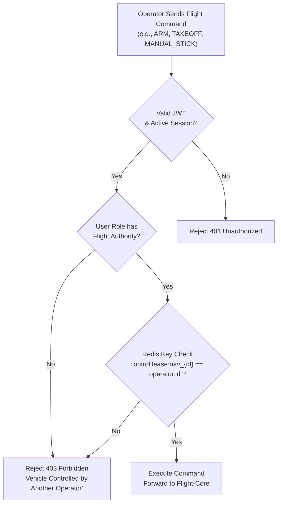

# Authentication & Security Architecture
## Fireblade Ground Control Station (GCS)

---

### Document Metadata
- **Module:** Security, Identity & Control Arbitration
- **Access Control:** Role-Based Access Control (RBAC) + Distributed Mutual Exclusion Lease
- **Token Mechanism:** Cryptographically Signed JSON Web Tokens (RS256 / HS256)

---

## 1. Role-Based Access Control (RBAC) Matrix

Operators have distinct operational responsibilities. To prevent unauthorized flight modifications, Fireblade GCS enforces a strict Role-Based Access Control matrix:

| Action / Capability | ADMIN | COMMANDER | PILOT_IN_COMMAND | PAYLOAD_OPERATOR | OBSERVER |
| :--- | :---: | :---: | :---: | :---: | :---: |
| **View Fleet Telemetry & Video** | Yes | Yes | Yes | Yes | Yes |
| **Create & Edit Waypoint Missions** | Yes | Yes | Yes | No | No |
| **Upload Missions to UAV** | Yes | Yes | Yes (Leased UAV only) | No | No |
| **Arm / Disarm Motors** | Yes | Yes | Yes (Leased UAV only) | No | No |
| **Switch Flight Mode (RTL, Loiter)** | Yes | Yes | Yes (Leased UAV only) | No | No |
| **Manual Gamepad Stick Flight** | No | Yes | Yes (Leased UAV only) | No | No |
| **Control Gimbal Pan / Tilt / Zoom** | No | Yes | Yes | Yes (Leased Camera) | No |
| **Acquire Flight Control Lease** | No | Yes | Yes | No | No |
| **Force Preempt Active Lease** | Yes | Yes | No | No | No |
| **User & Fleet Configuration** | Yes | No | No | No | No |

---

## 2. Distributed Control Lease Protocol

To prevent catastrophic dual-operator control conflicts (e.g., Pilot A ordering Left while Pilot B orders Right), Fireblade GCS implements an **Atomic Distributed Lease Engine** backed by Redis:

### 2.1 Atomic Lease Rules
1. **Acquisition:** Leases are acquired atomically via `SET control:lease:uav_{id} {operator_id} NX EX 30`. If another operator holds the lease, the acquisition fails immediately.
2. **Heartbeat Extension:** The pilot workstation sends a periodic lease heartbeat every 10 seconds. Each heartbeat extends the lease TTL by another 30 seconds.
3. **Dead-Man Expiration:** If the pilot's laptop loses Wi-Fi connection or the browser crashes, the lease expires within 30 seconds, automatically freeing the vehicle for another operator or commander to take control.
4. **Commander Override:** Mission Commanders possess the authority to invoke `force-preempt`. This revokes the current pilot's lease, issues a WebSocket revocation alert to their browser, and grants the lease to the commander.

---

## 3. Network Perimeter & RF Security

```mermaid
flowchart LR
    subgraph AirSegment["Airborne Segment"]
        UAV_AP["Autopilot (PX4)"]
        UAV_SEC["MAVLink v2 Packet Signing"]
    end

    subgraph RFLayer["Air-to-Ground RF Datalink"]
        AES_RF["WPA2-Enterprise / AES-256 Link Encryption"]
    end

    subgraph HostServer["Server PC Perimeter"]
        FW["UFW Firewall (Strict Port Ingress)"]
        NGINX_REV["Nginx Edge Ingress (TLS 1.3 / WSS)"]
        JWT_VAL["JWT Stateless Signature Validation"]
    end

    subgraph OperatorStations["Operator Browsers"]
        HTTPS_CLI["HTTPS Web App (Secure Cookies / LocalStorage)"]
    end

    UAV_AP <--> UAV_SEC
    UAV_SEC <--> AES_RF
    AES_RF <--> FW
    FW --> NGINX_REV
    NGINX_REV --> JWT_VAL
    JWT_VAL <--> HTTPS_CLI
```

### 3.1 Security Defenses
- **Port Minimization:** Only port 80/443 (HTTP/HTTPS), 8554 (RTSP), 8555 (WebRTC UDP), and 14550 (MAVLink UDP) are accessible through the firewall. All database (Postgres 5432) and cache (Redis 6379) ports are strictly bound to `127.0.0.1` and inaccessible from the LAN.
- **Cross-Origin Isolation:** Nginx sets `Cross-Origin-Opener-Policy: same-origin` and `Cross-Origin-Embedder-Policy: require-corp` to protect shared array buffers.
- **Tamper-Evident Audit Trails:** Every flight-critical command is written with an atomic transaction to `audit_logs` including operator UUID, workstation IP, exact parameter payload, and timestamp.
