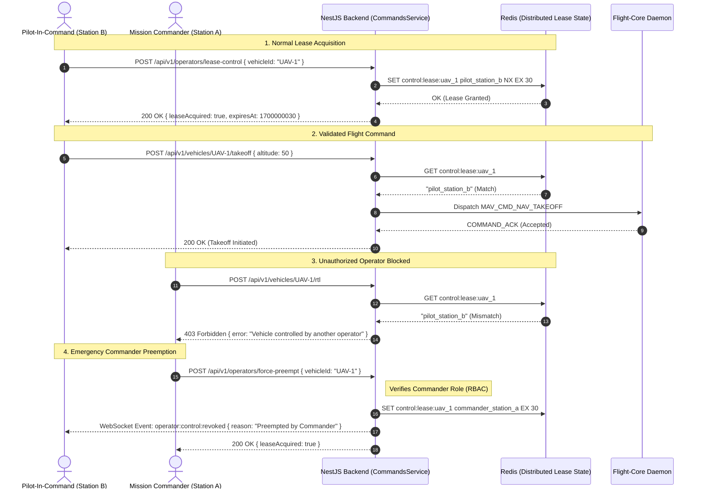

# Backend Architecture Specification
## Fireblade Ground Control Station (GCS)

---

### Document Metadata
- **Module:** Core Application & Gateway Architecture
- **Framework:** NestJS 10 / Node.js 20 LTS / TypeScript
- **Infrastructure:** Redis 7.2 (Pub/Sub & KV), PostgreSQL 16 + PostGIS, TimescaleDB

---

## 1. Architectural Philosophy & Core Responsibilities

The Fireblade GCS backend serves as the **operational brain and security perimeter** of the Ground Control Station. It coordinates operator interactions, manages vehicle flight states, arbitrates control conflicts, records flight data, and bridges browser clients with the low-level flight communications engine.

The backend is built upon **three non-negotiable architectural mandates**:
1. **Safety Interlocking (Zero Command Collisions):** No two operators can ever send flight commands to the same vehicle simultaneously. The backend enforces a strict, atomic **Control Lease** model using Redis distributed primitives.
2. **Event-Driven Telemetry Distribution:** Flight telemetry arriving from the MAVLink daemon is ingested via high-throughput Redis Pub/Sub and broadcast to client rooms via WebSockets without blocking request/response HTTP threads.
3. **Enterprise Modularity:** Domain capabilities are strictly encapsulated into NestJS modules, with dependency injection governing all service lifecycles.

---

## 2. Backend Subsystem Architecture

```mermaid
flowchart TD
    subgraph Ingress["Ingress & Transport Layer"]
        HTTP_IN["HTTP / REST Client Requests"]
        WS_IN["WebSocket Telemetry & Control Streams"]
    end

    subgraph NestCore["NestJS Application Core"]
        direction TB
        subgraph Middlewares["Security & Interceptors"]
            JWT_GUARD["JwtAuthGuard"]
            ROLES_GUARD["RolesGuard (RBAC)"]
            LEASE_GUARD["ControlLeaseGuard"]
            LOG_INTERCEPTOR["AuditLoggingInterceptor"]
        end

        subgraph Modules["Domain Feature Modules"]
            AUTH_MOD["AuthModule<br/>(Login, JWT, Sessions)"]
            VEH_MOD["VehiclesModule<br/>(Inventory, Status, Health)"]
            TEL_MOD["TelemetryModule<br/>(WebSocket Gateway, Broadcaster)"]
            CMD_MOD["CommandsModule<br/>(Arm, Mode, Takeoff, ACK Tracker)"]
            MIS_MOD["MissionsModule<br/>(Waypoints, GeoJSON, Validation)"]
            VID_MOD["VideoModule<br/>(MediaMTX API, Stream Registry)"]
            SYS_MOD["SystemModule<br/>(Host Health, CPU/RAM/Disk)"]
        end
    end

    subgraph DataTier["Data & Message Bus Tier"]
        REDIS_BUS[("Redis 7.2<br/>Pub/Sub & Distributed Locks")]
        POSTGRES_DB[("PostgreSQL 16 + PostGIS<br/>Relational & Spatial Store")]
        TIMESCALE_DB[("TimescaleDB<br/>Telemetry Hypertables")]
    end

    subgraph FlightCoreLink["Flight Core Interface"]
        FC_DAEMON["Flight Core Daemon (C++)<br/>Port 14550 UDP"]
    end

    HTTP_IN --> Middlewares
    WS_IN --> TEL_MOD

    Middlewares --> Modules

    AUTH_MOD --> POSTGRES_DB
    VEH_MOD --> POSTGRES_DB
    VEH_MOD <--> REDIS_BUS

    CMD_MOD --> LEASE_GUARD
    CMD_MOD <--> REDIS_BUS
    CMD_MOD --> POSTGRES_DB

    MIS_MOD --> POSTGRES_DB
    VID_MOD <--> POSTGRES_DB

    FC_DAEMON -->|High-Frequency Telemetry Push| REDIS_BUS
    REDIS_BUS -->|Pub/Sub Telemetry| TEL_MOD
    TEL_MOD --> WS_IN
    TEL_MOD -->|Batched INSERTs (1Hz)| TIMESCALE_DB
    CMD_MOD -->|Outgoing Command Push| REDIS_BUS
    REDIS_BUS -->|IPC Pop| FC_DAEMON
```

---

## 3. Modular Breakdown & Responsibilities

### 3.1 AuthModule
- **Controllers:** `AuthController` (`POST /api/v1/auth/login`, `POST /api/v1/auth/refresh`, `GET /api/v1/auth/me`).
- **Services:** `AuthService`, `JwtStrategy`.
- **Functionality:** Authenticates operator credentials using bcrypt password hashing. Issues signed RS256/HS256 JSON Web Tokens (JWT) containing user ID, role (`COMMANDER`, `PILOT`, `PAYLOAD_OPERATOR`, `OBSERVER`), and workstation identifier.

### 3.2 VehiclesModule
- **Controllers:** `VehiclesController` (`GET /api/v1/vehicles`, `GET /api/v1/vehicles/:id`, `PATCH /api/v1/vehicles/:id`).
- **Services:** `VehiclesService`.
- **Functionality:** Maintains the persistent vehicle catalog. Tracks real-time connection state (Connected, Degraded, Lost, Disconnected) by monitoring incoming heartbeat timestamps from the `FlightCore` daemon. Triggers warning events when a vehicle fails to send a heartbeat for more than 3000ms.

### 3.3 TelemetryModule
- **Gateways:** `TelemetryGateway` (Socket.IO namespace: `/telemetry`).
- **Services:** `TelemetryService`, `TelemetryBroadcaster`.
- **Functionality:**
  - Connects to Redis channel `telemetry:broadcast`.
  - Parses high-frequency binary/JSON packets pushed by `flight-core`.
  - Maintains an in-memory sliding window for instant state querying.
  - Groups clients into Socket.IO rooms based on vehicle subscriptions (`uav_${vehicleId}`).
  - Throttles broadcast frequency to a deterministic 30Hz to prevent saturating browser WebSockets.
  - Asynchronously batches telemetry records for persistent time-series logging into TimescaleDB.

### 3.4 CommandsModule
- **Controllers:** `CommandsController` (`POST /api/v1/vehicles/:id/command`, `POST /api/v1/vehicles/:id/arm`, `POST /api/v1/vehicles/:id/mode`, `POST /api/v1/vehicles/:id/takeoff`, `POST /api/v1/vehicles/:id/land`, `POST /api/v1/vehicles/:id/rtl`).
- **Services:** `CommandsService`, `LeaseService`.
- **Functionality:**
  - Enforces the **Control Lease** interlock. Rejects flight commands if the requesting operator does not hold an active lease.
  - Packages MAVLink `COMMAND_LONG` / `COMMAND_INT` payloads.
  - Publishes commands to Redis queue `commands:outgoing` for execution by `flight-core`.
  - Monitors the `COMMAND_ACK` feedback loop with a 3000ms timeout and automatic retry policy (up to 3 attempts).
  - Logs all command invocations to the immutable `audit_logs` table.

### 3.5 MissionsModule
- **Controllers:** `MissionsController` (`GET /api/v1/missions`, `POST /api/v1/missions`, `POST /api/v1/missions/:id/upload/:vehicleId`, `POST /api/v1/missions/download/:vehicleId`).
- **Services:** `MissionsService`, `MissionProtocolService`.
- **Functionality:**
  - Validates waypoint sequences (coordinate bounds, minimum/maximum altitude thresholds, maximum slope angle, geofence compliance).
  - Manages MAVLink Mission Protocol transactions (`MISSION_COUNT`, `MISSION_ITEM_INT`, `MISSION_ACK`) via `flight-core`.

### 3.6 VideoModule
- **Controllers:** `VideoController` (`GET /api/v1/video/streams`, `POST /api/v1/video/streams/:id/start`).
- **Services:** `VideoService`.
- **Functionality:** Coordinates with MediaMTX via its REST API. Registers incoming RTSP camera paths, monitors active stream bitrates and framerates, and generates WHEP endpoint URLs for client browser playback.

---

## 4. Single-Operator Control Lease Architecture

To guarantee flight safety, Fireblade GCS implements the **Single-Operator Control Lease** pattern:



---

## 5. High-Frequency Database Telemetry Batching

Writing high-frequency telemetry (30-50Hz across 32 UAVs = up to 1600 rows per second) row-by-row into a database would instantly exhaust database connection pools and disk I/O. 

**Fireblade GCS solves this via an In-Memory Ring Buffer & Micro-Batching Engine:**
1. Incoming telemetry packets update an in-memory hot state table immediately for zero-latency queries.
2. Packets are placed into a high-capacity in-memory array (`telemetryBatchQueue`).
3. A background timer running every **1000ms** drains the queue and executes a single multi-row parameterized `INSERT INTO telemetry_logs (...) VALUES (...)` statement into TimescaleDB.
4. Downsampling policies automatically retain full 10Hz data for 7 days, 1Hz data for 30 days, and 0.1Hz data indefinitely for historical compliance.

