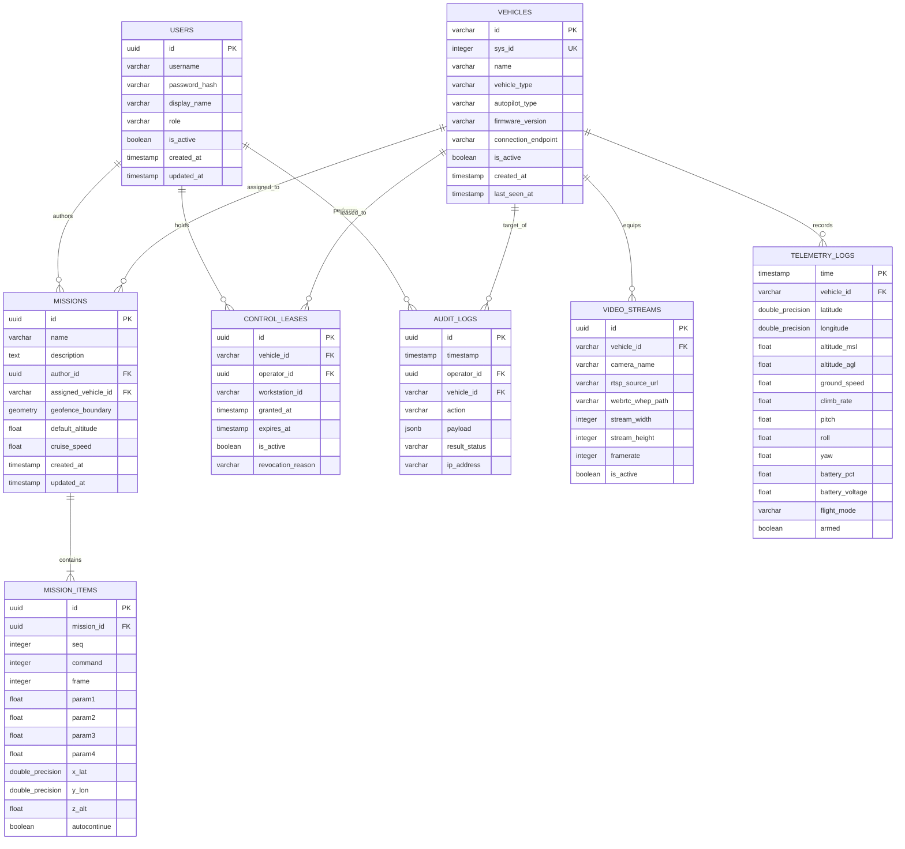

# Database Architecture Specification
## Fireblade Ground Control Station (GCS)

---

### Document Metadata
- **Engines:** PostgreSQL 16 (Relational & Spatial) + TimescaleDB Extension (Time-Series) + PostGIS 3.4
- **Cache & Bus:** Redis 7.2 (Pub/Sub & Distributed Locks)
- **Schema Management:** Automated TypeORM / Prisma Migrations

---

## 1. Persistence Philosophy & Hybrid Storage Model

Fireblade GCS handles two distinctly different classes of data:
1. **Relational & Spatial Metadata (ACID Compliant):** User accounts, vehicle configurations, mission waypoints, geofences, and immutable audit logs. Handled by **PostgreSQL 16 with PostGIS**.
2. **High-Frequency Flight Telemetry (Time-Series):** Continuous 10-50Hz updates of GPS coordinates, altitude, velocity, and battery stats across 32 active UAVs. Handled by **TimescaleDB hypertables**, which partition data automatically into 1-day chunks with lossless compression algorithms.

---

## 2. Entity-Relationship (ER) Diagram



---

## 3. Relational Table Specifications

### 3.1 `users`
- **Purpose:** Stores operator credentials and role-based permissions.
- **Columns:**
  - `id`: `UUID` PRIMARY KEY DEFAULT gen_random_uuid()
  - `username`: `VARCHAR(64)` UNIQUE NOT NULL
  - `password_hash`: `VARCHAR(255)` NOT NULL (Argon2id / bcrypt)
  - `display_name`: `VARCHAR(128)` NOT NULL
  - `role`: `VARCHAR(32)` NOT NULL (`ADMIN`, `COMMANDER`, `PILOT_IN_COMMAND`, `PAYLOAD_OPERATOR`, `OBSERVER`)
  - `is_active`: `BOOLEAN` DEFAULT true

### 3.2 `vehicles`
- **Purpose:** Hardware registry of discovered and provisioned UAVs.
- **Columns:**
  - `id`: `VARCHAR(64)` PRIMARY KEY (e.g. `uav_01`)
  - `sys_id`: `INTEGER` UNIQUE NOT NULL (MAVLink System ID 1..255)
  - `name`: `VARCHAR(128)` NOT NULL
  - `vehicle_type`: `VARCHAR(32)` NOT NULL (`QUADROTOR`, `HEXACOPTER`, `FIXED_WING`, `VTOL`)
  - `autopilot_type`: `VARCHAR(32)` NOT NULL (`PX4`, `ARDUPILOT`)
  - `firmware_version`: `VARCHAR(64)`

### 3.3 `missions` & `mission_items`
- **Purpose:** Stores flight paths, autonomous search grids, and waypoint lists compliant with MAVLink Mission Protocol.
- **Spatial Columns:** `geofence_boundary` (`GEOMETRY(Polygon, 4326)`) enforces spatial boundaries via PostGIS `ST_Contains`.

### 3.4 `audit_logs`
- **Purpose:** Tamper-evident flight command history.
- **Index:** `CREATE INDEX idx_audit_vehicle_time ON audit_logs (vehicle_id, timestamp DESC);`

---

## 4. TimescaleDB Telemetry Hypertable Specification

High-rate flight parameters are stored in the `telemetry_logs` hypertable:

```sql
-- Create Hypertable partitioned by 1-day time chunks
SELECT create_hypertable('telemetry_logs', 'time', chunk_time_interval => INTERVAL '1 day');

-- Enable TimescaleDB native compression
ALTER TABLE telemetry_logs SET (
  timescaledb.compress,
  timescaledb.compress_segmentby = 'vehicle_id',
  timescaledb.compress_orderby = 'time DESC'
);

-- Automatically compress chunks older than 2 days
SELECT add_compression_policy('telemetry_logs', INTERVAL '2 days');

-- Retention Policy: Drop raw 50Hz data older than 30 days
SELECT add_retention_policy('telemetry_logs', INTERVAL '30 days');
```

