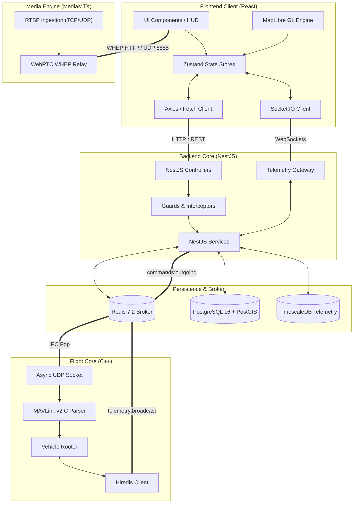

# Dependency Map & Library Registry
## Fireblade Ground Control Station (GCS)

---

### Document Metadata
- **Module:** Cross-Subsystem Dependency Graph & Third-Party Package Audit
- **License Compliance:** Strict Open-Source Software (OSS) Permissive Licenses (MIT, Apache-2.0, BSD-3-Clause)

---

## 1. Subsystem Inter-Dependency Graph

---

## 2. Third-Party Library Registry & Licenses

### 2.1 Frontend Dependencies (`client/package.json`)

| Package Name | Target Version | License | Architectural Purpose |
| :--- | :--- | :--- | :--- |
| **react** / **react-dom** | `^18.2.0` | MIT | Declarative virtual DOM rendering engine. |
| **typescript** | `^5.3.3` | Apache-2.0 | Compile-time static type safety and contract verification. |
| **vite** | `^5.1.0` | MIT | High-speed ESM development server and Rollup production bundler. |
| **zustand** | `^4.5.1` | MIT | Micro state management for 30Hz high-rate telemetry ring buffers. |
| **@tanstack/react-query** | `^5.20.5` | MIT | Server-state caching, invalidation, and REST data fetching. |
| **maplibre-gl** | `^4.0.0` | BSD-3-Clause | WebGL vector map rendering for tactical geospatial awareness. |
| **socket.io-client** | `^4.7.4` | MIT | WebSocket client for duplex telemetry and control streams. |
| **lucide-react** | `^0.330.0` | ISC | Lightweight tactical icon set (battery, sat, attitude, mode). |
| **tailwindcss** | `^3.4.1` | MIT | Utility-first styling framework for responsive cockpit UI. |

### 2.2 Backend Dependencies (`server/package.json`)

| Package Name | Target Version | License | Architectural Purpose |
| :--- | :--- | :--- | :--- |
| **@nestjs/core** / **common** | `^10.3.3` | MIT | Enterprise modular backend framework with dependency injection. |
| **@nestjs/websockets** | `^10.3.3` | MIT | WebSocket adapter supporting room-based client subscriptions. |
| **@nestjs/passport** / **jwt** | `^10.0.3` | MIT | Stateless authentication and RBAC authorization tokens. |
| **typeorm** / **pg** | `^0.3.20` | MIT | PostgreSQL ORM, connection pool management, and migrations. |
| **ioredis** | `^5.3.2` | MIT | High-performance async Redis client for Pub/Sub and locks. |
| **class-validator** | `^0.14.1` | MIT | DTO runtime validation for all inbound flight command requests. |

### 2.3 Flight-Core Native Dependencies (`flight-core/`)

| Library Name | Version | License | Architectural Purpose |
| :--- | :--- | :--- | :--- |
| **MAVLink C Library v2** | `v2.0` | LGPL-3.0 / MIT | Binary serialization and deserialization of MAVLink frames. |
| **Asio (Standalone C++)** | `1.28.0` | BSL-1.0 | Asynchronous UDP socket I/O without heavy thread overhead. |
| **hiredis** | `1.2.0` | BSD-3-Clause | Minimal C client library for Redis protocol serialization. |

---

## 3. Circular Dependency Prevention Protocol

To maintain architectural stability and prevent runtime deadlocks:
1. **Unidirectional Hierarchy:** Layered dependencies strictly follow `Client -> Ingress -> Backend Core -> Broker -> Flight Core`. Reverse imports are strictly prohibited.
2. **DTO Isolation:** Data Transfer Objects (DTOs) and TypeScript interfaces are isolated in dedicated `types/` directories and never import active services or controllers.
3. **Automated Lint Checks:** ESLint with `import/no-cycle` is configured in CI to reject any circular dependency across modules.
