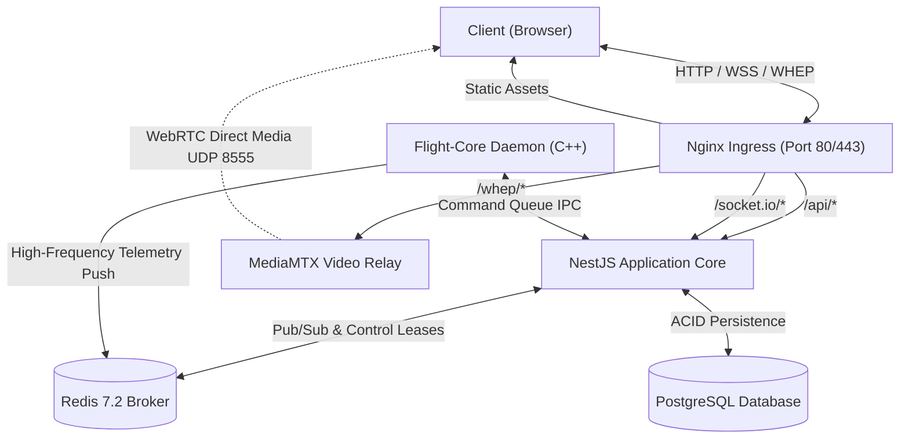

# Directory Structure & Repository Layout
## Fireblade Ground Control Station (GCS)

---

### Document Metadata
- **Module:** Codebase Organization & Canonical Layout
- **Classification:** Architectural Blueprint
- **Target System:** Monorepo Architecture for Multi-Service GCS

---

## 1. Monorepo Structural Philosophy

Fireblade GCS employs a **unified modular monorepo** structure. This design guarantees:
1. **Atomic Commits:** Full-stack features (such as adding a new MAVLink payload message, its backend routing, and its frontend HUD widget) can be introduced, tested, and reviewed within a single cohesive pull request.
2. **Shared Type Definitions:** Common TypeScript interfaces (e.g., telemetry packet models, vehicle status enums, mission item structures) are shared directly between frontend and backend without serialization mismatches.
3. **Coordinated Containerized Deployment:** A single `docker-compose.yml` orchestrates the frontend, backend, video engine, message broker, and databases simultaneously.

---

## 2. Comprehensive Directory Tree

```
fireblade-gcs/
│
├── .github/                                # CI/CD workflows and automated quality checks
│   └── workflows/
│       ├── ci.yml                          # Lint, typecheck, unit tests, and build checks
│       ├── docker-build.yml                # Multi-arch Docker container build and image registry push
│       └── security-scan.yml               # Snyk / Trivy dependency vulnerability and secret audit
│
├── docs/                                   # Project documentation and specifications
│   ├── architecture/                       # Official system architecture documents (15 volumes)
│   │   ├── README.md                       # Master index & architecture guide
│   │   ├── SYSTEM_OVERVIEW.md              # System mission, CONOPS, performance constraints
│   │   ├── DIRECTORY_STRUCTURE.md          # Repository layout & module roles (this file)
│   │   ├── FILE_BY_FILE_DOCUMENTATION.md   # Exhaustive source file specification
│   │   ├── FRONTEND_ARCHITECTURE.md        # React/TS client architecture, PFD, map engine
│   │   ├── BACKEND_ARCHITECTURE.md         # NestJS application core, services, gateways
│   │   ├── MAVLINK_ARCHITECTURE.md         # MAVLink v2 parser, sysId routing, ACK lifecycle
│   │   ├── VIDEO_STREAMING_ARCHITECTURE.md # RTSP, GStreamer, MediaMTX WebRTC pipeline
│   │   ├── API_AND_WEBSOCKET_DOCUMENTATION.md # REST endpoints & WebSocket event catalog
│   │   ├── DATABASE_ARCHITECTURE.md        # PostgreSQL schema, TimescaleDB, ER diagrams
│   │   ├── AUTHENTICATION_AND_SECURITY.md  # RBAC, JWT, atomic control lease protocol
│   │   ├── EXECUTION_WORKFLOWS.md          # 18 end-to-end execution sequence workflows
│   │   ├── DEPLOYMENT_AND_NETWORK_ARCHITECTURE.md # Docker, Nginx, dual-NIC network topology
│   │   ├── DEPENDENCY_MAP.md               # Internal/external dependency trees & licenses
│   │   └── TECHNICAL_AUDIT.md              # Risk audit, telemetry bottlenecks, roadmap
│   ├── api/                                # Generated OpenAPI (Swagger) specifications
│   └── user-guide/                         # Operator and deployment manual
│
├── client/                                 # Frontend Application (React 18 + TypeScript + Vite)
│   ├── public/                             # Static assets, icons, map styles, offline tiles
│   │   ├── assets/icons/                   # SVG indicators (attitude, GPS, battery, mode)
│   │   └── tiles/                          # Basemap cache definition
│   ├── src/
│   │   ├── api/                            # Axios / Fetch client and REST API service bindings
│   │   │   ├── auth.api.ts                 # Login, session refresh, profile
│   │   │   ├── vehicles.api.ts             # Vehicle CRUD, command triggers, flight modes
│   │   │   ├── missions.api.ts             # Mission upload, download, validation
│   │   │   └── video.api.ts                # Stream registry and WebRTC session negotiation
│   │   ├── components/                     # Reusable UI component library
│   │   │   ├── common/                     # Buttons, modals, tooltips, status badges
│   │   │   ├── hud/                        # Primary Flight Display (PFD) and artificial horizon
│   │   │   │   ├── ArtificialHorizon.tsx   # Canvas-based pitch/roll attitude indicator
│   │   │   │   ├── AltimeterTape.tsx       # Scrolling vertical altitude indicator (MSL/AGL)
│   │   │   │   ├── AirspeedTape.tsx        # Indicated and ground speed indicator
│   │   │   │   ├── CompassRose.tsx         # Heading and course over ground dial
│   │   │   │   └── PfdOverlay.tsx          # Master glass-cockpit HUD wrapper
│   │   │   ├── map/                        # Tactical Map Components (MapLibre GL)
│   │   │   │   ├── TacticalMap.tsx         # Main map container with WebGL tile layers
│   │   │   │   ├── VehicleMarker.tsx       # Multi-vehicle icons with heading rotation
│   │   │   │   ├── TrajectoryLayer.tsx     # Historic breadcrumb trail & planned path
│   │   │   │   ├── GeofenceLayer.tsx       # Keep-in / Keep-out polygon visualization
│   │   │   │   └── WaypointEditor.tsx      # Interactive point-and-click mission creation
│   │   │   ├── video/                      # Live Payload Video Components
│   │   │   │   ├── WebRtcPlayer.tsx        # Standard HTML5 video with WHEP client
│   │   │   │   ├── CameraSelector.tsx      # Multi-camera toggle (EO vs. IR thermal)
│   │   │   │   └── GimbalController.tsx    # On-screen PTZ and click-to-center controls
│   │   │   ├── controls/                   # Command & Control Panels
│   │   │   │   ├── FlightModeSelector.tsx  # Mode switcher (Loiter, RTL, Auto, PosHold)
│   │   │   │   ├── ArmingSwitch.tsx        # Two-stage safety arm/disarm slider
│   │   │   │   ├── CommandToolbar.tsx      # Quick actions (Takeoff, Land, Pause, RTL)
│   │   │   │   └── LeaseBadge.tsx          # Real-time control ownership status badge
│   │   │   └── telemetry/                  # Fleet summary and health monitors
│   │   │       ├── FleetOverviewGrid.tsx   # Card grid for all detected UAVs
│   │   │       ├── BatteryGauge.tsx        # Voltage, current draw, remaining %
│   │   │       ├── LinkQualityBar.tsx      # RSSI, packet loss, telemetry frequency
│   │   │       └── StatusMessageList.tsx   # Scrolling MAVLink STATUSTEXT message log
│   │   ├── hooks/                          # Custom React Hooks
│   │   │   ├── useTelemetry.ts             # High-frequency WebSocket telemetry subscription
│   │   │   ├── useVehicle.ts               # Active vehicle selection and properties
│   │   │   ├── useControlLease.ts          # Lease acquisition, heartbeat, preemption
│   │   │   ├── useGamepad.ts               # HTML5 Gamepad API mapping for RC sticks
│   │   │   └── useWebRtcStream.ts          # WHEP negotiation and connection state
│   │   ├── pages/                          # Primary Application Views
│   │   │   ├── DashboardPage.tsx           # Multi-panel tactical command view
│   │   │   ├── MissionPlannerPage.tsx      # Full-screen waypoint and survey planner
│   │   │   ├── FleetManagementPage.tsx     # Vehicle configuration, calibration, params
│   │   │   ├── VideoWallPage.tsx           # Multi-stream concurrent video exploitation
│   │   │   └── LoginPage.tsx               # Operator authentication and station assignment
│   │   ├── stores/                         # Global State Stores (Zustand)
│   │   │   ├── vehicleStore.ts             # In-memory fleet registry and active vehicle ID
│   │   │   ├── telemetryStore.ts           # Decoupled high-frequency telemetry ring buffers
│   │   │   ├── controlStore.ts             # Active operator lease and authority state
│   │   │   └── uiStore.ts                  # Layout configuration, theme, audio alerts
│   │   ├── types/                          # Shared Frontend TypeScript Type Definitions
│   │   │   ├── telemetry.types.ts          # Attitude, GPS, Battery, Status interfaces
│   │   │   ├── vehicle.types.ts            # Vehicle entity, state enums, capabilities
│   │   │   └── mission.types.ts            # Waypoint, command, and geofence schemas
│   │   ├── App.tsx                         # Master routing and context provider wrapper
│   │   ├── main.tsx                        # React DOM root entry point
│   │   └── index.css                       # Tailwind CSS directives and custom styling
│   ├── package.json                        # Frontend dependencies and npm scripts
│   ├── tsconfig.json                       # TypeScript compiler configuration
│   └── vite.config.ts                      # Vite build configuration and dev server proxy
│
├── server/                                 # Backend Application (NestJS + TypeScript)
│   ├── src/
│   │   ├── config/                         # Environment and application configuration
│   │   │   ├── database.config.ts          # PostgreSQL and TimescaleDB connection options
│   │   │   ├── redis.config.ts             # Redis connection and pub/sub options
│   │   │   └── app.config.ts               # Server port, JWT secrets, CORS settings
│   │   ├── database/                       # Database schema, entities, migrations
│   │   │   ├── entities/                   # TypeORM / Prisma entity definitions
│   │   │   │   ├── User.entity.ts          # Operator credentials and role assignment
│   │   │   │   ├── Vehicle.entity.ts       # Registered UAV hardware metadata
│   │   │   │   ├── Mission.entity.ts       # Mission plan headers and spatial geofences
│   │   │   │   ├── MissionItem.entity.ts   # Individual ordered waypoint coordinates
│   │   │   │   ├── ControlLease.entity.ts  # Audit history of vehicle control handovers
│   │   │   │   ├── AuditLog.entity.ts      # Immutable operator command history
│   │   │   │   └── VideoSource.entity.ts   # Registered RTSP camera configurations
│   │   │   ├── migrations/                 # Versioned database migration scripts
│   │   │   └── database.module.ts          # Database connection provider module
│   │   ├── modules/                        # Modular NestJS Domain Feature Modules
│   │   │   ├── auth/                       # Authentication and authorization
│   │   │   │   ├── auth.controller.ts      # Login, refresh, and profile endpoints
│   │   │   │   ├── auth.service.ts         # Password hashing, JWT issuance, verification
│   │   │   │   ├── jwt.strategy.ts         # Passport JWT authentication strategy
│   │   │   │   └── roles.guard.ts          # RBAC endpoint authorization guard
│   │   │   ├── vehicles/                   # Vehicle lifecycle management
│   │   │   │   ├── vehicles.controller.ts  # Vehicle inventory and parameters
│   │   │   │   ├── vehicles.service.ts     # Vehicle discovery, heartbeat timeout monitor
│   │   │   │   └── dto/                    # Vehicle creation and update DTOs
│   │   │   ├── telemetry/                  # Telemetry ingestion, buffering, and fan-out
│   │   │   │   ├── telemetry.gateway.ts    # Socket.IO WebSocket gateway for live clients
│   │   │   │   ├── telemetry.service.ts    # Ingestion from Redis pub/sub and batch logging
│   │   │   │   └── telemetry-broadcaster.ts# Room-based 30Hz telemetry throttler
│   │   │   ├── commands/                   # Flight Command & Control dispatch
│   │   │   │   ├── commands.controller.ts  # REST triggers for Arm, Mode, Takeoff, Land
│   │   │   │   ├── commands.service.ts     # Command formatting, ACK tracking, retries
│   │   │   │   └── lease.service.ts        # Atomic Redis control lease mutual exclusion
│   │   │   ├── missions/                   # Waypoint generation, storage, and sync
│   │   │   │   ├── missions.controller.ts  # Mission CRUD and upload/download triggers
│   │   │   │   ├── missions.service.ts     # Waypoint sequence packaging & verification
│   │   │   │   └── mission-protocol.service.ts # MAVLink mission microservice handshake
│   │   │   ├── video/                      # Video stream orchestration
│   │   │   │   ├── video.controller.ts     # Available streams and camera status
│   │   │   │   ├── video.service.ts        # MediaMTX API interaction & health monitoring
│   │   │   │   └── gstreamer-launcher.ts   # Transcoder process supervisor (if needed)
│   │   │   └── system/                     # System diagnostics and hardware health
│   │   │       ├── system.controller.ts    # Server CPU, RAM, disk, and network stats
│   │   │       └── system.service.ts       # Host diagnostic telemetry collector
│   │   ├── app.module.ts                   # Root NestJS application module
│   │   └── main.ts                         # NestJS bootstrapping and server initialization
│   ├── package.json                        # Backend dependencies and build scripts
│   └── tsconfig.json                       # Backend TypeScript compiler configuration
│
├── flight-core/                            # Dedicated MAVLink Flight Communications Core
│   ├── src/                                # High-throughput C++ / Node native daemon
│   │   ├── main.cpp                        # Standalone gateway daemon entry point
│   │   ├── UdpConnection.hpp               # Asynchronous UDP socket listener (Port 14550)
│   │   ├── UdpConnection.cpp               # Socket read/write, buffer management
│   │   ├── SerialConnection.hpp            # Hardware UART / USB telemetry radio interface
│   │   ├── SerialConnection.cpp            # Hardware serial port parsing
│   │   ├── MavlinkParser.hpp               # Zero-copy MAVLink v2 binary unpacker
│   │   ├── MavlinkParser.cpp               # Heartbeat detection, CRC check, message routing
│   │   ├── VehicleRouter.hpp               # Multi-UAV routing table keyed by sysId
│   │   ├── VehicleRouter.cpp               # Thread-safe message queue per vehicle
│   │   ├── RedisPublisher.hpp              # High-frequency telemetry publisher to Redis
│   │   └── RedisPublisher.cpp              # Hiredis client publishing binary/JSON packets
│   ├── include/                            # MAVLink v2 C header library (common & standard)
│   │   └── mavlink/v2.0/                   # Generated C headers for MAVLink protocol
│   ├── CMakeLists.txt                      # C++ build script (Modern CMake 3.20+)
│   └── package.json                        # Node-API wrapper bindings (optional binding layer)
│
├── deploy/                                 # Infrastructure, Containers & Deployment
│   ├── docker/                             # Dockerfiles for each service
│   │   ├── Dockerfile.frontend             # Multi-stage build for React client (Nginx)
│   │   ├── Dockerfile.backend              # Multi-stage Node.js build for NestJS API
│   │   └── Dockerfile.flight-core          # Multi-stage C++ build with Alpine/Ubuntu base
│   ├── mediamtx/                           # MediaMTX Streaming Server Configuration
│   │   └── mediamtx.yml                    # RTSP ingestion, WebRTC/WHEP enable, port mappings
│   ├── nginx/                              # Nginx Edge Ingress Configuration
│   │   ├── nginx.conf                      # Master Nginx configuration
│   │   └── conf.d/
│   │       └── fireblade.conf              # Reverse proxy routes, WebSocket upgrade, WHEP
│   ├── scripts/                            # Operational management scripts
│   │   ├── init-db.sh                      # PostgreSQL and TimescaleDB extension setup
│   │   ├── setup-server.sh                 # Host OS configuration, firewall, kernel UDP tuning
│   │   └── start-dev.sh                    # Local development multi-process launcher
│   └── docker-compose.yml                  # Production multi-container composition
│
└── README.md                               # Root repository orientation and quickstart guide
```

---

## 3. Module Boundaries & Communication Rules

To maintain long-term maintainability, strict communication boundaries are enforced:



1. **Client Never Talks Directly to Flight-Core:** The web client has no direct socket connection to the physical MAVLink UDP port (14550). All commands pass through NestJS for authentication, authorization, and control-lease verification.
2. **Flight-Core Has No Database Access:** The flight communication daemon is kept lean and stateless. It does not perform SQL queries or disk I/O; it forwards raw or parsed telemetry packets directly into Redis memory buffers.
3. **Video Data Bypasses Application Logic:** High-bitrate video streams (H.264/H.265 at 4-15 Mbps) bypass Node.js entirely. MediaMTX ingests the RTSP streams from the radios and serves WebRTC WHEP sessions directly to browsers, ensuring the Node.js event loop remains dedicated to flight state and telemetry.
