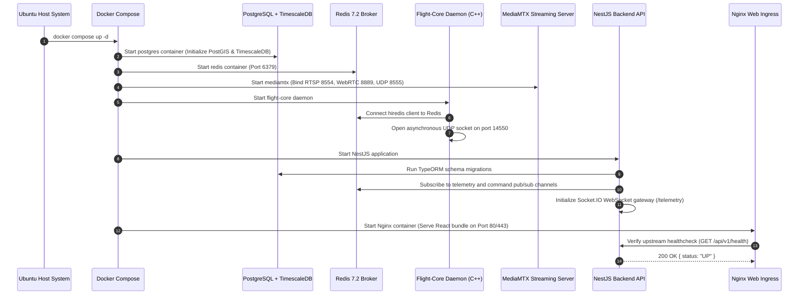
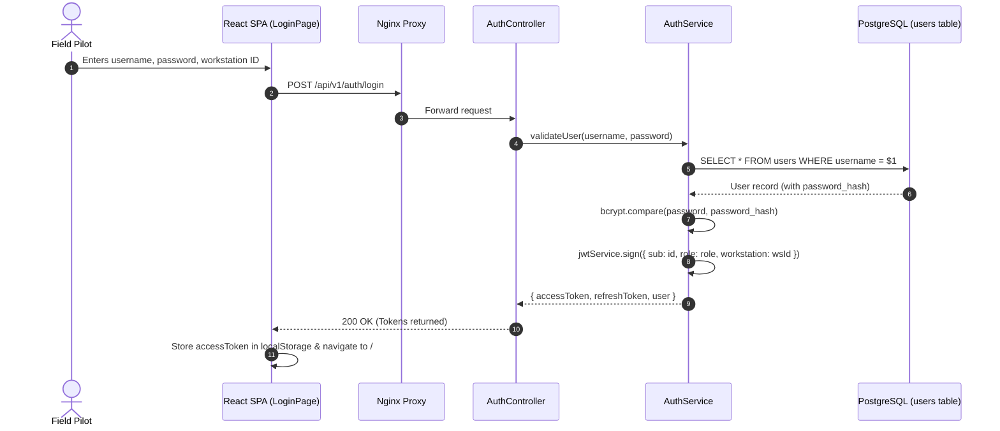
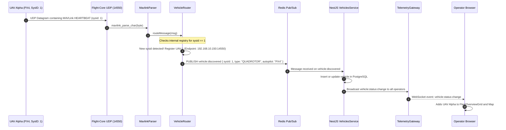
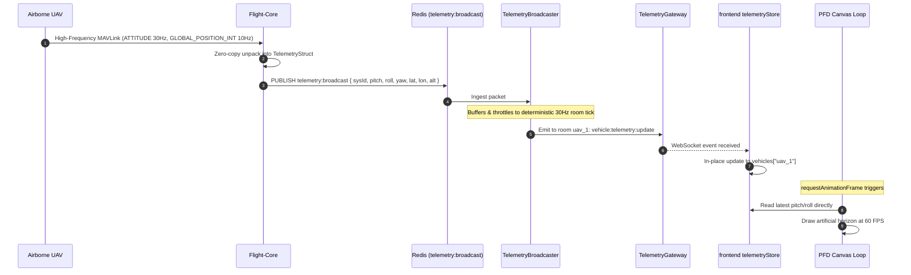

# End-to-End Execution Workflows
## Fireblade Ground Control Station (GCS)

---

### Document Metadata
- **Module:** System Runtime Dynamics & Sequence Specifications
- **Workflows Documented:** 18 Critical End-to-End Operational Workflows
- **Implementation Status:** Architecture Specification (Greenfield Inception Phase)

---

## Workflow 1: Application Startup & System Boot

- **Files Involved:** `deploy/docker-compose.yml`, `flight-core/src/main.cpp`, `server/src/main.ts`, `server/src/database/database.module.ts`.
- **Functions:** `UdpConnection::startReceive()`, `NestFactory.create()`, `app.listen()`.

---

## Workflow 2: Operator Authentication & Session Creation

- **Files:** `client/src/pages/LoginPage.tsx`, `server/src/modules/auth/auth.service.ts`.
- **Functions:** `AuthService.login()`, `useAuthStore.setSession()`.

---

## Workflow 3: Dashboard Initialization & State Hydration

1. Browser renders `DashboardPage.tsx`.
2. React mounts `WebSocketProvider.tsx` and establishes socket connection `ws://server/telemetry?token=JWT`.
3. Frontend issues `GET /api/v1/vehicles` to hydrate existing fleet list.
4. Tactical Map initializes WebGL canvas, loading offline vector style from `/tiles/style.json`.

---

## Workflow 4: UAV Connection & Multi-UAV Discovery

- **Files:** `flight-core/src/MavlinkParser.cpp`, `flight-core/src/VehicleRouter.cpp`, `server/src/modules/vehicles/vehicles.service.ts`.

---

## Workflow 5: MAVLink Telemetry Reception & UI Updates

---

## Workflow 6: Vehicle Selection & Control Lease Acquisition

1. Operator clicks UAV-1 in `FleetOverviewGrid.tsx`.
2. UI updates `controlStore.selectedVehicleId = 'uav_1'`.
3. Operator clicks **"Acquire Flight Control"**.
4. Frontend triggers `POST /api/v1/operators/lease-control { vehicleId: 'uav_1' }`.
5. Backend invokes `leaseService.acquireLease()`. Redis executes `SET control:lease:uav_1 operator_id NX EX 30`.
6. Lease granted: UI updates `LeaseBadge` to green ("CONTROL ACTIVE").

---

## Workflow 7: Command Execution (Arming & Takeoff)

1. Operator slides `ArmingSwitch.tsx` to ARM.
2. Frontend sends `POST /api/v1/vehicles/uav_1/arm { arm: true }`.
3. `CommandsController` verifies operator holds active lease via `ControlLeaseGuard`.
4. `CommandsService` formats MAVLink `COMMAND_LONG` (Msg 76) with command `MAV_CMD_COMPONENT_ARM_DISARM`.
5. Packet pushed to `commands:outgoing` in Redis.
6. `FlightCore` transmits UDP packet to UAV-1.
7. Autopilot verifies safety checks and returns `COMMAND_ACK` (MAV_RESULT_ACCEPTED).
8. Backend resolves pending HTTP promise; UI displays "ARMED" status.

---

## Workflow 8: Mission Planning & Waypoint Upload

1. Operator opens `MissionPlannerPage.tsx`.
2. Clicks on tactical map to drop waypoints (WP 1: Takeoff, WP 2: Survey Point, WP 3: Survey Point, WP 4: RTL).
3. Client validates altitude limits and geofence intersections.
4. Clicks **"Upload Mission to UAV"**.
5. Backend initiates MAVLink Mission Protocol: sends `MISSION_COUNT (4)`.
6. Autopilot requests each item via `MISSION_REQUEST_INT(seq)`.
7. Backend streams corresponding `MISSION_ITEM_INT` coordinates.
8. Autopilot verifies checksum and emits `MISSION_ACK (MAV_MISSION_ACCEPTED)`.

---

## Workflow 9: Camera Connection & WebRTC Video Streaming

1. Airborne payload camera boots and serves RTSP at `rtsp://192.168.10.150:8554/cam1`.
2. MediaMTX detects stream path on-demand via `mediamtx.yml`.
3. Operator browser mounts `WebRtcPlayer.tsx`.
4. Browser generates WebRTC SDP offer and sends `POST /whep/live/uav_1_cam_1`.
5. MediaMTX binds video track and returns SDP answer (201 Created).
6. ICE gathering completes over UDP port 8555; browser displays live video with < 150ms glass-to-glass latency.

---

## Workflow 10: Operator Control Handover & Preemption

1. Pilot A holds control of UAV-1.
2. Pilot B requests handover via UI.
3. Pilot A receives in-app confirmation modal: "Transfer control to Pilot B?".
4. If approved: Backend deletes Pilot A's lease key and sets Pilot B's key.
5. In an emergency: Commander invokes **"Force Preempt"**, immediately seizing control lease and notifying Pilot A via WebSocket.

---

## Workflow 11: Vehicle Disconnection & Timeout Recovery

1. UAV-1 experiences RF jamming or moves behind terrain.
2. `FlightCore` heartbeat scanner notes no packet for 3000ms.
3. GCS flags vehicle status as `LOST_HEARTBEAT`; UI triggers audio chime.
4. At 10000ms: Status transitions to `DISCONNECTED`; control lease is revoked.
5. Autopilot on-board failsafe activates: UAV autonomously enters **RTL (Return-To-Launch)**.
6. When UAV regains line-of-sight and transmits a heartbeat, `FlightCore` automatically restores connection state to `STREAMING_TELEMETRY`.

---

## Workflow 12: Backend Crash & Failover Recovery

1. If the NestJS process crashes, Docker automatically restarts the container (`restart: unless-stopped`).
2. Because Redis maintains active lease state in memory, control leases persist across backend restarts without disruption.
3. Operators' browser WebSocket connections reconnect with exponential backoff and resume telemetry display instantly.

