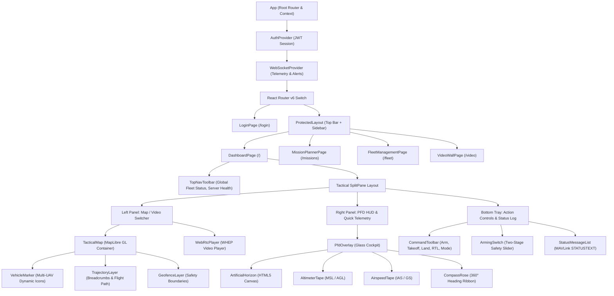
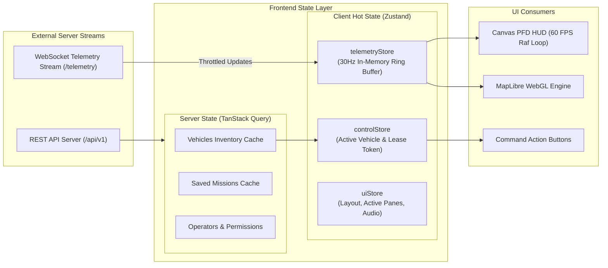

# Frontend Architecture Specification
## Fireblade Ground Control Station (GCS)

---

### Document Metadata
- **Module:** Client Application Architecture
- **Framework:** React 18 / TypeScript / Vite / TailwindCSS
- **Rendering Engines:** HTML5 Canvas (PFD/HUD), MapLibre GL JS (Vector Map), WebRTC/WHEP (Video)

---

## 1. Architectural Philosophy & Design Principles

The Fireblade GCS frontend is an **operator-centric, low-latency, mission-critical Single Page Application (SPA)**. In tactical UAV operations, a front-end UI failure or frame drop during flight control can result in loss of situational awareness or vehicle damage. To guarantee determinism and responsiveness, the client adheres to four core principles:

1. **Decoupled Telemetry vs. DOM Render Pipelines:** High-frequency flight telemetry (arriving over WebSockets at 30-50Hz per vehicle) must **never** trigger full React component tree re-renders. Dynamic telemetry visualization (such as the Artificial Horizon and Altitude/Speed tapes) is rendered directly using hardware-accelerated **HTML5 Canvas 2D contexts** synchronized with browser `requestAnimationFrame` cycles.
2. **Single-Store Multi-Vehicle State Partitioning:** State for up to 32 active UAVs is partitioned within an in-memory Zustand store. Individual components subscribe only to their selected vehicle's sub-slice, eliminating cascading update penalties.
3. **Sub-150ms Zero-Plugin Video:** Video feeds from airborne payloads are ingested via native browser WebRTC using the standardized WebRTC HTTP Egress Protocol (WHEP), avoiding bulky plugins or high-latency HLS/DASH buffering.
4. **Safety-First Ergonomics:** Flight-critical actions (Arming, Disarming, Takeoff, Return-To-Launch, Emergency Pause) utilize two-stage confirmation gestures (slider or modal verification) to prevent accidental mouse clicks.

---

## 2. Component Hierarchy & Layout Structure

The user interface follows a modular, tile-based dashboard layout:



---

## 3. State Management Architecture



### 3.1 Store Breakdown
1. **`telemetryStore` (Zustand):**
   - Holds real-time spatial coordinates (lat, lon, alt), velocities, attitude angles (pitch, roll, yaw), battery voltage/percentage, and GPS fix state.
   - Designed with direct mutative setters for speed, avoiding deep object cloning on every 30Hz packet.
2. **`controlStore` (Zustand):**
   - Tracks the active vehicle selected by the operator (`selectedVehicleId`).
   - Maintains the client's current **Control Lease** state: whether the local operator holds the exclusive flight command token for the active UAV, the lease expiration timestamp, and preemption warnings.
3. **`vehicleStore` (TanStack Query + Zustand):**
   - Retains metadata: vehicle model, firmware type (PX4 vs. ArduPilot), serial number, MAVLink sysId/compId, and communication link status.
4. **`uiStore` (Zustand):**
   - Manages screen split ratios, HUD overlay visibility toggles, measurement unit preferences (Metric vs. Imperial), and visual/audio alert acknowledgments.

---

## 4. Primary Flight Display (PFD) High-Rate Rendering Loop

To achieve fluid, tear-free **60 FPS** flight instruments without impacting React DOM performance, the PFD HUD uses a **Direct Canvas Drawing Loop** driven by `requestAnimationFrame`:

```typescript
// Architectural implementation pattern for Canvas PFD
export const useCanvasAnimation = (
  canvasRef: React.RefObject<HTMLCanvasElement>,
  vehicleId: string
) => {
  useEffect(() => {
    let animationFrameId: number;
    const canvas = canvasRef.current;
    if (!canvas) return;
    const ctx = canvas.getContext('2d');
    if (!ctx) return;

    const render = () => {
      // 1. Fetch latest telemetry directly from in-memory store without triggering React render
      const telemetry = useTelemetryStore.getState().vehicles[vehicleId];
      if (telemetry) {
        // 2. Clear canvas viewport
        ctx.clearRect(0, 0, canvas.width, canvas.height);
        
        // 3. Draw Pitch & Roll Horizon
        drawArtificialHorizon(ctx, canvas.width, canvas.height, telemetry.pitch, telemetry.roll);
        
        // 4. Draw Flight Director & Crosshairs
        drawCrosshairs(ctx, canvas.width, canvas.height);
      }

      // 5. Schedule next frame
      animationFrameId = requestAnimationFrame(render);
    };

    animationFrameId = requestAnimationFrame(render);
    return () => cancelAnimationFrame(animationFrameId);
  }, [vehicleId]);
};
```

---

## 5. MapLibre GL Integration Architecture

The tactical map provides full geospatial situational awareness:
- **Offline Capability:** Configured to load pre-seeded vector tiles from the local server (`http://server-ip/tiles/style.json`), allowing fully air-gapped operation in field environments with zero internet access.
- **Dynamic Vehicle Symbols:** Each UAV is represented by an independent GeoJSON feature. Vehicle symbols are updated dynamically using `map.getSource('vehicles').setData(...)` at 10-20Hz.
- **Interactive Waypoint Mission Tooling:** Allows operators to click to create waypoints, drag waypoint handles to adjust coordinates, and configure altitude and speed in real-time.

---

## 6. Real-Time Gamepad / Joystick Flight Control

For manual or assisted manual piloting, the client interfaces directly with the browser's standard **HTML5 Gamepad API**:
- **Polling Loop:** A dedicated high-priority 50Hz interval polls connected USB gamepads (e.g., Xbox, PlayStation, or FrSky/Radiomaster USB RC transmitters).
- **Stick Mapping:** Normalizes axes into standard MAVLink `MANUAL_CONTROL` channels:
  - Axis 0 (Roll): -1000 to +1000
  - Axis 1 (Pitch): -1000 to +1000
  - Axis 2 (Throttle): 0 to 1000
  - Axis 3 (Yaw): -1000 to +1000
- **Safety Interlock:** Gamepad inputs are only transmitted to the backend if the operator holds an active, verified **Control Lease** for that vehicle. If the browser tab loses focus, stick commands immediately zero out to prevent runaway conditions.
