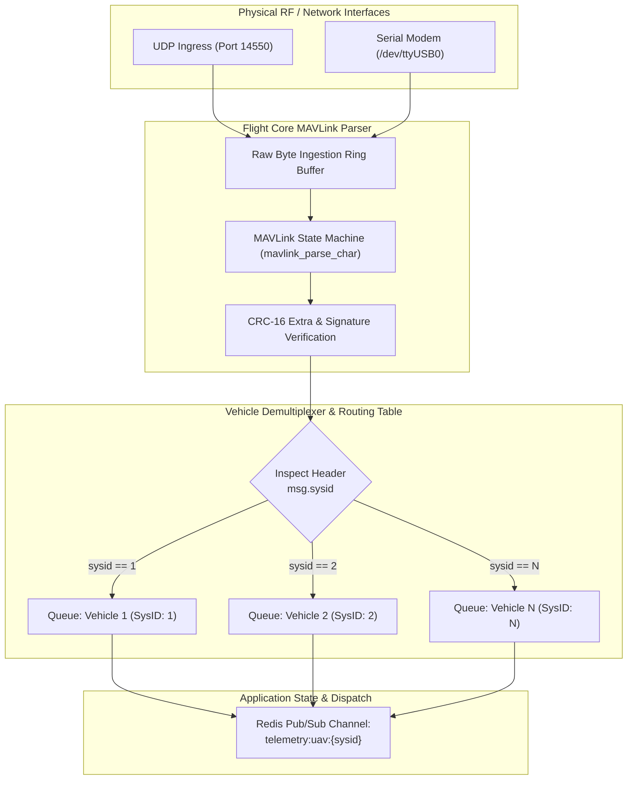
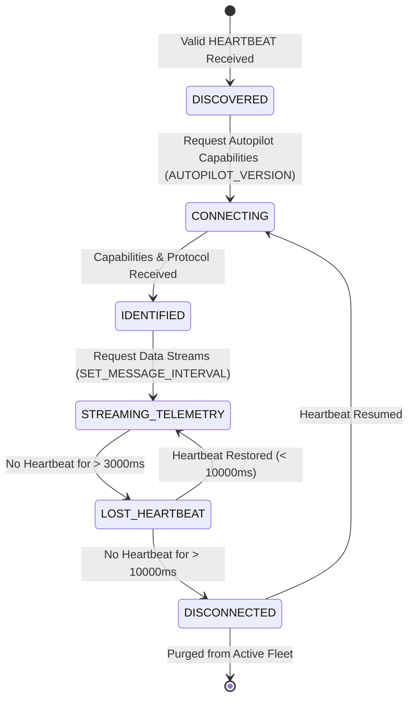
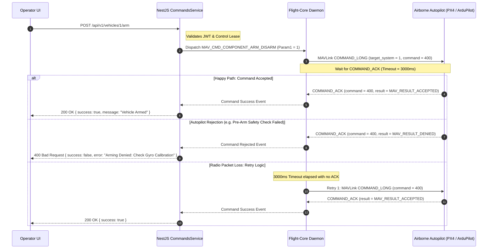
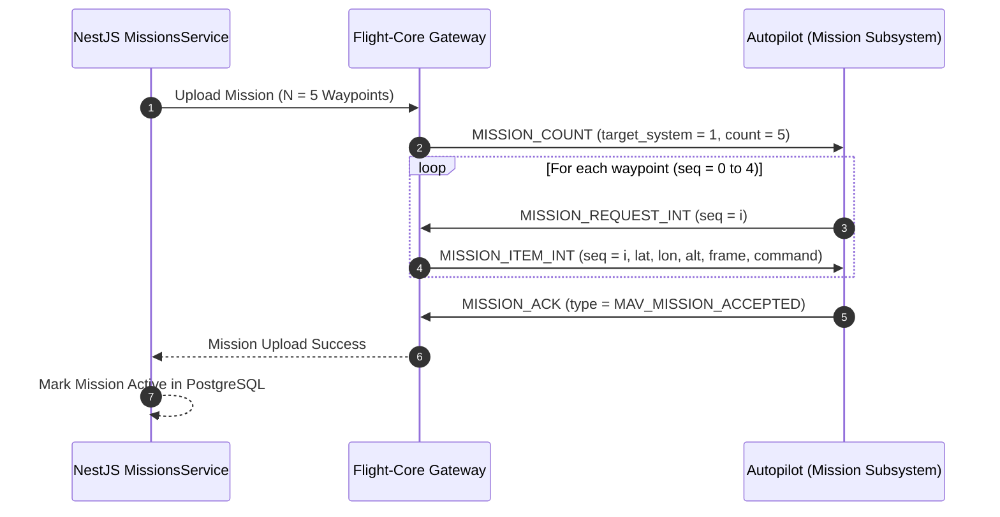

# MAVLink & Multi-UAV Architecture Specification
## Fireblade Ground Control Station (GCS)

---

### Document Metadata
- **Protocol:** MAVLink v2 (Micro Air Vehicle Link)
- **Transport Layers:** UDP (Default: 14550), TCP (5760), Serial UART / USB (115200 / 57600 baud)
- **Autopilot Compatibility:** PX4 Autopilot (v1.13+) and ArduPilot (ArduCopter / ArduPlane / ArduRover 4.0+)
- **Concurrency Target:** 32+ simultaneous independent UAVs

---

## 1. MAVLink Protocol Foundation

Fireblade GCS communicates with airborne autopilots using the **MAVLink v2** framing standard. MAVLink v2 provides significant operational advantages over v1:
1. **24-bit Message IDs:** Extends the message catalog to 16 million unique message types, supporting advanced payload sensors, collision avoidance, and swarm protocols.
2. **Packet Signing (Security):** Cryptographic SHA-256 signatures can be appended to the packet trailer, protecting ground-to-air flight commands against packet injection and spoofing over open RF links.
3. **Payload Truncation / Zero-Byte Suppression:** Automatically strips trailing zero bytes from telemetry packets, saving up to 40% bandwidth on low-baud rate radio datalinks (e.g., 57600 baud RFD900x modems).

```
MAVLink v2 Packet Structure:
+----+------+------+--------+--------+--------+--------+--------+--------+--------+--------+--------+
| STX| LEN  | INC  | CMP    | SEQ    | SYS_ID | COMP_ID|   MSG_ID (3B)   | PAYLOAD|   CRC  | SIGN   |
|0xFD|0..255| FLAGS| FLAGS  | 0..255 | 1..255 | 1..255 | Byte 0, 1, 2    | 0..255B| 2 Bytes| 13 Bytes|
+----+------+------+--------+--------+--------+--------+--------+--------+--------+--------+--------+
```

---

## 2. Multi-UAV Routing & System ID Isolation

A critical vulnerability in naive multi-UAV GCS designs is **cross-talk**: sending a command intended for UAV 1 that is accidentally executed by UAV 2. Fireblade GCS guarantees zero cross-talk through a **Strict Routing & Isolation Architecture**:



### 2.1 Routing Invariant Rules:
1. **Dynamic Vehicle Discovery:** When a packet containing a previously unseen `sysid` arrives with a valid `HEARTBEAT` message, a new `VehicleState` context is dynamically instantiated in the routing table.
2. **Endpoint Binding:** The routing table binds each `sysid` to its originating physical endpoint (e.g., remote IP `192.168.10.150` and UDP port `14555`). All outgoing commands targeting that `sysid` are routed exclusively to that endpoint.
3. **No Broadcast Commands:** Operational flight commands (`ARM`, `TAKEOFF`, `SET_MODE`, `RTL`) are **never** broadcast (`sysid: 0`). They are strictly unicast to the specific target system ID.

---

## 3. Vehicle Connection Lifecycle State Machine

Each discovered vehicle is tracked through an explicit state machine:



### 3.1 State Definitions
- **`DISCOVERED`:** First valid `HEARTBEAT` (Msg 0) packet received from an unknown `sysid`. GCS registers presence and extracts vehicle type (`MAV_TYPE_QUADROTOR`, `MAV_TYPE_FIXED_WING`) and autopilot brand (`MAV_AUTOPILOT_PX4` or `MAV_AUTOPILOT_ARDUPILOTMEGA`).
- **`CONNECTING`:** GCS transmits `MAV_CMD_REQUEST_MESSAGE` for `AUTOPILOT_VERSION` (Msg 148) to discover firmware capabilities, UID, and flight limits.
- **`IDENTIFIED`:** Vehicle hardware profile resolved and persisted in PostgreSQL `vehicles` table.
- **`STREAMING_TELEMETRY`:** Operating state. GCS requests high-frequency streams:
  - Attitude (`ATTITUDE`, Msg 30): 30 Hz
  - Global Position (`GLOBAL_POSITION_INT`, Msg 33): 10 Hz
  - Flight Instruments (`VFR_HUD`, Msg 74): 10 Hz
  - System Status / Battery (`SYS_STATUS`, Msg 1): 2 Hz
  - GPS Diagnostics (`GPS_RAW_INT`, Msg 24): 2 Hz
- **`LOST_HEARTBEAT`:** No heartbeat received for > 3.0 seconds. The GCS raises an immediate visual and acoustic warning to operators ("Telemetry Link Degraded").
- **`DISCONNECTED`:** No heartbeat received for > 10.0 seconds. Link is flagged offline; active flight control leases are revoked.

---

## 4. Flight Command & Acknowledgement (ACK) Lifecycle

All ground-to-air commands are executed through a robust transactional handshake:



---

## 5. MAVLink Mission Protocol Implementation

Waypoint mission uploads follow the official MAVLink Mission Protocol state machine:



### 5.1 Mission Safety Rules:
1. **Coordinate Frame:** Always use `MAV_FRAME_GLOBAL_RELATIVE_ALT_INT` (WGS84 lat/lon scaled by 1e7, altitude in millimeters above ground takeoff elevation).
2. **Terrain Clearance:** Waypoints are validated against a Digital Elevation Model (DEM) before transmission to prevent CFIT (Controlled Flight Into Terrain).
3. **Emergency Rally Points:** Every mission plan includes pre-computed emergency rally points and automatic geofence inclusion polygons.

