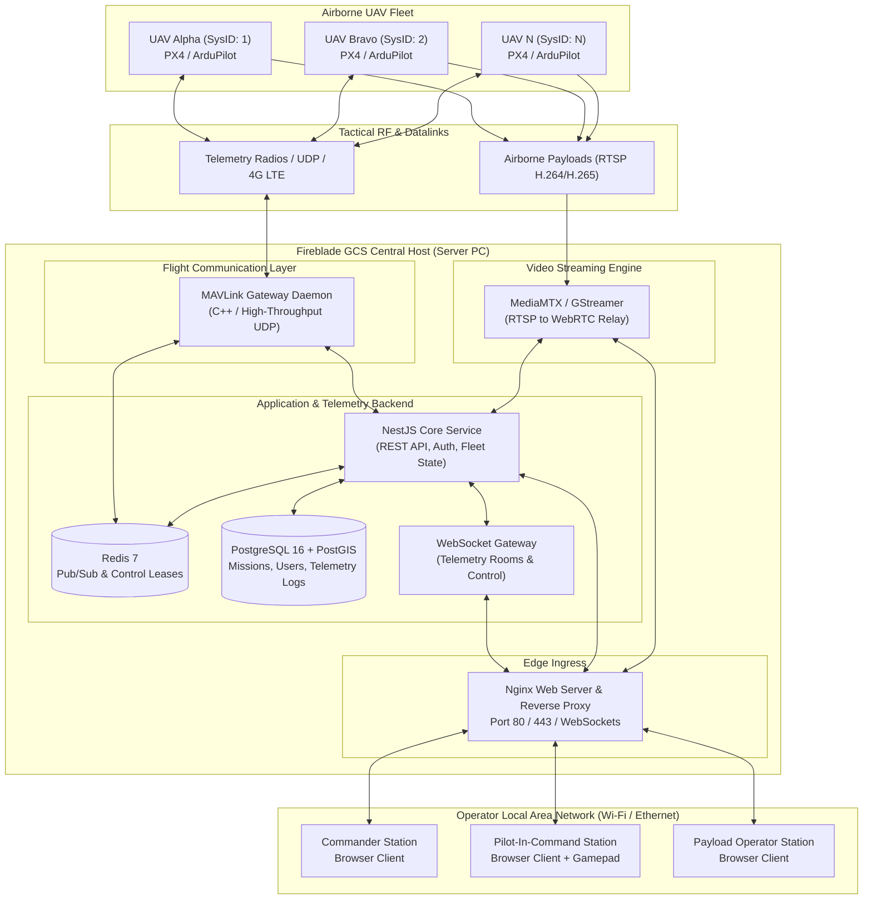

# Fireblade Ground Control Station (GCS)
## Software Architecture & Technical Documentation

---

### Document Information
- **Product Name:** Fireblade GCS
- **Full Title:** Fireblade Ground Control Station
- **Product Category:** Centralized IP-Based Browser Multi-UAV Ground Control Station
- **Architecture Version:** 1.0.0-RELEASE
- **Document Status:** Official Technical Architecture Reference & Implementation Blueprint
- **Target Environment:** Single Server PC (Linux / Docker) accessed via LAN / Browser clients
- **Classification:** Technical Architecture Specification

---

## 1. Executive Summary

**Fireblade GCS** is an enterprise-grade, browser-based, multi-UAV (Unmanned Aerial Vehicle) Ground Control Station engineered for centralized command, telemetry visualization, mission planning, and real-time video exploitation. Unlike traditional native desktop GCS applications (e.g., QGroundControl, Mission Planner) that require dedicated fat-client software installations on individual pilot laptops, Fireblade GCS operates on a **Server-Edge Architecture**:

1. A single industrial Server PC (or ruggedized tactical field computer) hosts the core flight communication gateway, video ingestion/relay engines, telemetry pub/sub message brokers, and centralized database.
2. Multiple operators, pilots, payload specialists, and mission commanders access the station simultaneously through standard web browsers (Chrome, Edge, Firefox) by navigating to the server's local IP address over an Ethernet or Wi-Fi local area network (LAN).
3. The platform establishes simultaneous, bi-directional MAVLink communication with multiple UAVs, while ingesting multi-channel RTSP video streams from airborne payloads and delivering sub-150ms glass-to-glass WebRTC streams to web clients.

---

## 2. Repository Inception & Audit Status

### 2.1 Workspace Analysis
- **Root Directory:** `D:\FireBlade`
- **Remote Origin:** `https://github.com/Daksh7112003/FireBlade.git`
- **Current Inception State:** Greenfield / Project Genesis Phase.
- **Source Code Files Present in Root at Inception:** 0 application source files.
- **Repository Context:** As verified through repository state analysis and workspace directory inspection, the repository is newly created on GitHub and initialized locally. 

### 2.2 Objective of this Architecture Reference
This documentation package serves as the **complete, authoritative, and binding engineering specification** for Fireblade GCS. It defines:
- The target technology stack, verified against production requirements for high-performance UAV operations.
- The concrete modular directory layout.
- The file-by-file specification of every source module, class, interface, and hook.
- Detailed communication protocols for MAVLink v2 packet routing and sub-150ms WebRTC video distribution.
- End-to-end execution workflows and sequence diagrams.
- Database schemas with ER diagrams.
- A thorough technical audit highlighting concurrency risks, security attack surfaces, and mitigation strategies.

---

## 3. Architecture Documentation Map

This documentation suite is organized into 15 specialized, cross-referenced architectural specifications located in `docs/architecture/`:

| Document | Primary Focus | Key Content |
| :--- | :--- | :--- |
| **[SYSTEM_OVERVIEW.md](file:///d:/FireBlade/docs/architecture/SYSTEM_OVERVIEW.md)** | System Overview | Mission, operational concept, high-level architecture, subsystem boundaries, performance constraints. |
| **[DIRECTORY_STRUCTURE.md](file:///d:/FireBlade/docs/architecture/DIRECTORY_STRUCTURE.md)** | Repository Layout | Canonical file tree, module placement, separation of concerns, build artifacts. |
| **[FILE_BY_FILE_DOCUMENTATION.md](file:///d:/FireBlade/docs/architecture/FILE_BY_FILE_DOCUMENTATION.md)** | Source File Specification | Exhaustive breakdown of every planned source file, class, method, hook, and interface. |
| **[FRONTEND_ARCHITECTURE.md](file:///d:/FireBlade/docs/architecture/FRONTEND_ARCHITECTURE.md)** | React/TypeScript Client | UI hierarchy, MapLibre/Cesium integration, WebGL PFD HUD, Zustand stores, state updates. |
| **[BACKEND_ARCHITECTURE.md](file:///d:/FireBlade/docs/architecture/BACKEND_ARCHITECTURE.md)** | NestJS Application Core | Dependency injection tree, controllers, services, WebSocket gateways, Redis event routing. |
| **[MAVLINK_ARCHITECTURE.md](file:///d:/FireBlade/docs/architecture/MAVLINK_ARCHITECTURE.md)** | Flight Communications | MAVLink v2 parsing, vehicle discovery, System ID isolation, command ACKs, waypoint upload/download. |
| **[VIDEO_STREAMING_ARCHITECTURE.md](file:///d:/FireBlade/docs/architecture/VIDEO_STREAMING_ARCHITECTURE.md)** | Video Pipeline | RTSP ingestion, GStreamer pipelines, MediaMTX WebRTC (WHEP) distribution, multi-camera switching. |
| **[API_AND_WEBSOCKET_DOCUMENTATION.md](file:///d:/FireBlade/docs/architecture/API_AND_WEBSOCKET_DOCUMENTATION.md)** | Interface Contracts | Full REST API route schemas, request/response payloads, WebSocket event catalog, DTO validation. |
| **[DATABASE_ARCHITECTURE.md](file:///d:/FireBlade/docs/architecture/DATABASE_ARCHITECTURE.md)** | Persistence Layer | PostgreSQL schema, PostGIS spatial types, TimescaleDB telemetry tables, entity-relationship diagrams. |
| **[AUTHENTICATION_AND_SECURITY.md](file:///d:/FireBlade/docs/architecture/AUTHENTICATION_AND_SECURITY.md)** | Security & RBAC | JWT token lifecycle, operator roles, atomic Control Lease protocol, RF spoofing mitigations. |
| **[EXECUTION_WORKFLOWS.md](file:///d:/FireBlade/docs/architecture/EXECUTION_WORKFLOWS.md)** | End-to-End Workflows | 18 detailed execution sequence diagrams covering startup, telemetry, commands, handover, failover. |
| **[DEPLOYMENT_AND_NETWORK_ARCHITECTURE.md](file:///d:/FireBlade/docs/architecture/DEPLOYMENT_AND_NETWORK_ARCHITECTURE.md)** | Infrastructure | Ubuntu host configuration, Docker Compose, dual-NIC networking, firewall rules, Nginx proxy. |
| **[DEPENDENCY_MAP.md](file:///d:/FireBlade/docs/architecture/DEPENDENCY_MAP.md)** | Dependency Graph | Internal module dependency matrices, third-party library licenses, cyclic dependency guards. |
| **[TECHNICAL_AUDIT.md](file:///d:/FireBlade/docs/architecture/TECHNICAL_AUDIT.md)** | Technical Risk Audit | Comprehensive vulnerability analysis, telemetry bottlenecks, race conditions, phased roadmap. |

---

## 4. Key Architectural Constants & Technology Matrix

| Subsystem | Selected Technology | Architectural Justification |
| :--- | :--- | :--- |
| **Frontend Framework** | **React 18 + TypeScript + Vite** | High-performance virtual DOM, strict static typing, modular component reuse, rapid HMR development. |
| **Map Engine** | **MapLibre GL JS + Deck.gl** | WebGL-accelerated vector mapping, custom drone icon rotation, smooth high-frequency trajectory overlays. |
| **Backend Framework** | **NestJS (Node.js 20 LTS)** | Enterprise modularity, native TypeScript, integrated WebSocket Gateways, microservice extensibility. |
| **Flight Communications** | **MAVLink Gateway (C++ / Node-API)** | Zero-copy UDP socket handling, deterministic binary deserialization, prevents Node event-loop starvation. |
| **Message Broker & Cache** | **Redis 7.2 (Pub/Sub & In-Memory KV)** | Sub-millisecond telemetry fan-out, atomic control lease management via `SET NX EX`. |
| **Primary Database** | **PostgreSQL 16 + PostGIS** | ACID relational storage for missions, users, audit logs, and spatial geofences. |
| **Telemetry History** | **TimescaleDB Extension** | Optimized hypertable chunking for high-frequency (50Hz) time-series flight data persistence. |
| **Video Engine** | **MediaMTX + GStreamer 1.22** | Native RTSP ingestion, zero-re-encoding H.264 WebRTC pass-through, WHEP protocol for browser playback. |
| **Ingress & Web Server** | **Nginx 1.24+** | High-throughput static file caching, TLS termination, WebSocket connection upgrading, WHEP proxying. |

---

## 5. Architectural Quality Standards

All architectural specifications within this suite adhere strictly to the following standards:
1. **Determinism:** Real function names, class names, file paths, endpoints, and event strings are documented.
2. **Explicit Implementation State:** Every module explicitly states whether it is `[IMPLEMENTED]`, `[IN PROGRESS]`, or `[PLANNED ARCHITECTURE]`.
3. **No Phantom Code:** No assumption is made without documenting the precise interfaces, types, and logic required.
4. **Security by Design:** Security mechanisms (RBAC, Single-Operator Control Leases, input validation, network isolation) are baked into every layer.
