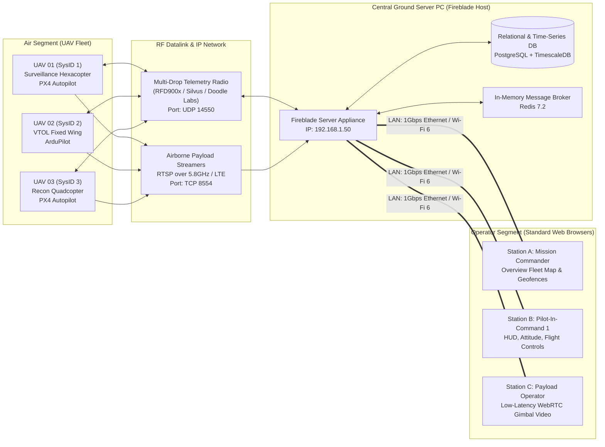
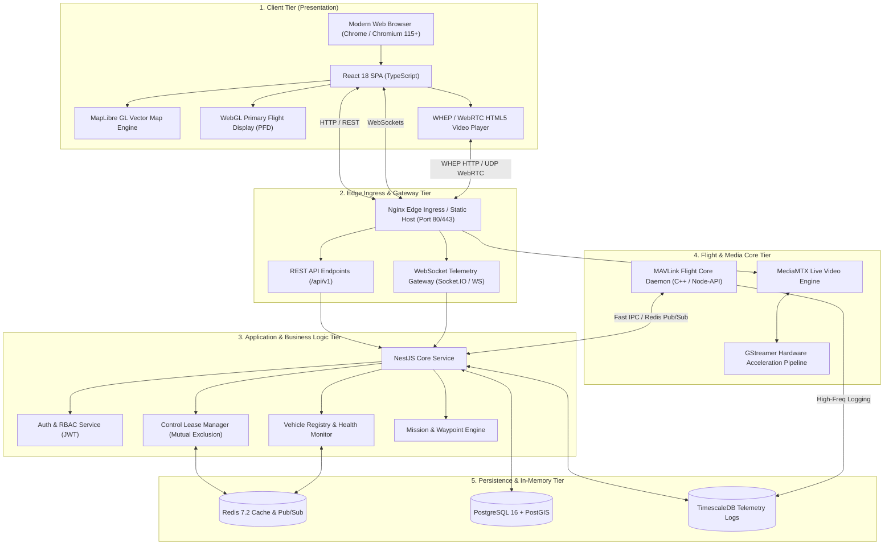

# System Overview
## Fireblade Ground Control Station (GCS)

---

### Document Metadata
- **Module:** System Architecture & Operational Concept
- **Classification:** Architectural Blueprint
- **Target Audience:** Systems Engineers, Software Architects, Flight Operations Personnel

---

## 1. System Mission & Core Purpose

**Fireblade GCS** is a centralized, IP-based, multi-UAV Ground Control Station engineered to decouple flight command and control from physical workstations. In conventional drone operations, each operator laptop runs a standalone, native desktop software instance (such as QGroundControl or Mission Planner) tethered directly via USB to an RF telemetry modem. This traditional model suffers from severe operational constraints:
- **No Shared Situational Awareness:** Operators cannot seamlessly view other vehicles or synchronize missions in real-time.
- **Hardware Tethering:** Moving control requires physically handing over laptops or moving USB cables.
- **Client Resource Overload:** Decoding high-resolution video streams and parsing dense telemetry simultaneously saturates field laptop CPUs and GPUs.
- **Installation & Version Drift:** Every laptop must be manually installed, updated, and configured.

**Fireblade GCS resolves these challenges through a centralized IP-based server model:**
1. A single **Server PC** (deployed in a command van, mobile operations center, or base station) is connected directly to the datalinks (RF telemetry modems, cellular 4G/5G gateways, satellite links, and RTSP video receivers).
2. The server runs the Fireblade core platform—handling all MAVLink flight communications, video stream ingestion, telemetry demultiplexing, database logging, and WebSocket broadcasting.
3. Any operator equipped with a standard computer, laptop, or ruggedized tablet connects over the local network (LAN) using a web browser to the server's IP address (e.g., `http://192.168.1.50`).
4. Multiple operators can collaborate in real-time: a **Commander** oversees the entire fleet map; individual **Pilots-in-Command (PIC)** command specific UAVs using USB gamepads or point-and-click waypoints; and **Payload Operators** manipulate gimbal cameras independently.

---

## 2. Operational Concept (CONOPS)

---

## 3. High-Level Subsystem Architecture

The system is decomposed into five distinct operational tiers:

### 3.1 Subsystem Functional Descriptions

#### Subsystem A: Flight Communication Engine (Flight-Core)
- **Primary Responsibility:** Interfacing with physical radio datalinks (UDP, TCP, Serial) and speaking native MAVLink v2.
- **Isolation Principle:** Runs independently of the web application thread. Heavy binary packet parsing, checksum verification, and dynamic heartbeat pinging occur in a dedicated high-throughput C++/Node native module.
- **Multi-UAV Demultiplexing:** Inspects incoming `sysid` (System ID) in every MAVLink packet header and partitions data into isolated vehicle state queues.

#### Subsystem B: Media & Video Relay Engine (Media-Core)
- **Primary Responsibility:** Translating airborne RTSP/H.264/H.265 streams into browser-native, ultra-low-latency WebRTC streams.
- **Underlying Technology:** MediaMTX (an ultra-fast zero-dependency RTSP/WebRTC server) integrated with GStreamer for hardware-accelerated decode/re-packetization.
- **Protocol:** Uses the IETF standard **WHEP (WebRTC HTTP Egress Protocol)** for sub-150ms video delivery without requiring third-party browser plugins or heavy client-side transcoding.

#### Subsystem C: Application & Telemetry Gateway (Backend-Core)
- **Primary Responsibility:** Orchestrating business logic, operator authentication, role-based vehicle access, mission storage, and telemetry broadcast.
- **Technology:** NestJS (Node.js 20 LTS) utilizing Fastify/Express and Socket.IO for room-based telemetry fan-out.
- **Control Concurrency:** Implements the **Single-Operator Control Lease** pattern via Redis atomic primitives to guarantee that two operators can never send conflicting flight commands to the same vehicle simultaneously.

#### Subsystem D: Operator Web Client (Frontend-Core)
- **Primary Responsibility:** High-fidelity, real-time tactical user interface.
- **Technology:** React 18 with TypeScript, compiled with Vite.
- **Visualization:**
  - **Tactical Map:** Powered by MapLibre GL JS with 60 FPS vector tile rendering, offline satellite caching, and elevation profiles.
  - **Primary Flight Display (PFD):** HTML5 Canvas / WebGL artificial horizon, airspeed tape, altimeter tape, compass rose, and flight director.
  - **Video HUD Overlay:** Glass-cockpit style telemetry overlaid directly onto the WebRTC video stream.

#### Subsystem E: Data & State Persistence (Storage-Core)
- **PostgreSQL 16:** Relational integrity for user accounts, fleet inventory, mission plans, geofences, and immutable audit logs.
- **PostGIS:** Spatial spatial querying for geofencing, terrain elevation intersection, and no-fly-zone containment checks.
- **TimescaleDB:** Automated chunking and compression for multi-million row high-frequency flight telemetry logs.
- **Redis 7.2:** Transient hot state, sub-millisecond Pub/Sub bus between Flight-Core and WebSocket Gateways, and distributed control locks.

---

## 4. Key Architectural Constraints & Performance Budgets

| Metric | Budget / Target | Architectural Strategy |
| :--- | :--- | :--- |
| **Video Latency (Glass-to-Glass)** | **< 150 ms** | RTSP-to-WebRTC pass-through without transcoding; hardware H.264 parsing; WHEP protocol. |
| **Telemetry Ingestion Rate** | **50 Hz per UAV** | C++ MAVLink parser; binary deserialization; circular memory buffers. |
| **Telemetry UI Render Rate** | **30 - 60 FPS** | Decoupled React state from animation frame loop; HTML5 Canvas/WebGL for PFD rendering. |
| **Max Concurrent UAVs** | **32 Active Vehicles** | Isolated per-SysID message pipelines; Redis channel sharding (`telemetry:uav:<id>`). |
| **Max Concurrent Operators** | **50 Web Clients** | WebSocket room subscriptions; Nginx event-driven connection scaling; Redis pub/sub fanout. |
| **Command Latency (Click to RF)** | **< 20 ms** | Direct memory queue from HTTP/WebSocket gateway to Flight-Core UDP socket. |
| **Flight Command Reliability** | **100% ACK Tracked** | MAVLink command acknowledgment tracking with 3 retries and 3000ms timeout window. |

---

## 5. Technology Stack Summary (Planned vs. Inception State)

| Component | Target Architecture | Implementation State | Justification |
| :--- | :--- | :--- | :--- |
| **Client Core** | React 18, TypeScript, Vite | Greenfield Blueprint | Industry standard for scalable single-page applications. |
| **State Management** | Zustand + TanStack Query | Greenfield Blueprint | Minimal re-renders, clean separation of server vs UI state. |
| **Map Rendering** | MapLibre GL JS | Greenfield Blueprint | Open-source, WebGL accelerated, supports custom offline vector/raster mbtiles. |
| **Backend Core** | NestJS 10, Node.js 20 LTS | Greenfield Blueprint | Robust enterprise dependency injection, built-in WebSocket support. |
| **MAVLink Stack** | MAVLink v2 (C++ / Node-API) | Greenfield Blueprint | Deterministic performance; eliminates V8 garbage collection jitter during flight control. |
| **Video Ingestion** | MediaMTX + GStreamer 1.22 | Greenfield Blueprint | Lowest latency RTSP-to-WebRTC bridging with zero pipeline lag. |
| **Database** | PostgreSQL 16 + TimescaleDB | Greenfield Blueprint | Enterprise ACID storage combined with specialized time-series hypertables. |
| **Cache & Bus** | Redis 7.2 | Greenfield Blueprint | Microsecond latency pub/sub and atomic control lease locking. |
| **Deployment** | Docker Compose + Nginx | Greenfield Blueprint | Turnkey one-command deployment on Ubuntu server hardware. |
