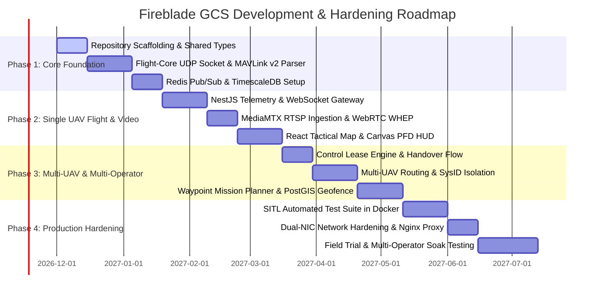

# Technical Audit & Architectural Risk Assessment
## Fireblade Ground Control Station (GCS)

---

### Document Metadata
- **Audit Type:** Technical Risk, Scalability, Concurrency & Security Audit
- **Repository State:** Greenfield Inception Phase (0 source files in root workspace, clean repository on GitHub)
- **Target System:** IP-Based Multi-UAV Browser Ground Control Station

---

## 1. Executive Summary & Audit Context

Fireblade GCS is designed to address a critical capability gap in unmanned systems command: replacing siloed, fat-client desktop GCS software with a centralized, multi-operator, browser-accessible ground station.

Because the repository is currently at the **Genesis / Greenfield Inception Phase**, this technical audit evaluates:
1. **Architectural vulnerabilities** inherent in the proposed technology stack if implemented naively.
2. **Concurrency, scalability, and performance bottlenecks** specific to multi-UAV flight control and low-latency video relay.
3. **Security attack surfaces** across air-ground RF links and local operator LANs.
4. **Concrete mitigations and defensive patterns** that must be enforced during active development.

---

## 2. In-Depth Technical Audit Findings

### Finding 1: Single Node.js Event Loop Telemetry Starvation
- **Affected Subsystem / File:** `server/src/modules/telemetry/telemetry.service.ts`
- **Category:** Performance & Reliability Bottleneck
- **Problem Description:** If MAVLink binary packet parsing and per-packet TimescaleDB database writes are executed directly inside the Node.js main thread, receiving 50Hz telemetry from 32 UAVs (1600 pkts/sec) will saturate the V8 event loop. This causes timer drift, delayed WebSocket broadcasts, and unresponsiveness in flight command APIs.
- **Technical Impact:** **CRITICAL**. High latency in command processing (> 500ms) could cause delayed emergency pauses or delayed collision avoidance commands.
- **Recommended Mitigation:**
  1. Decouple binary MAVLink parsing into the standalone C++ `flight-core` daemon.
  2. Use Redis Pub/Sub as an in-memory buffer.
  3. Throttle frontend WebSocket fan-out to a deterministic 30Hz room tick in Node.js.
  4. Write telemetry to TimescaleDB in 1000ms micro-batches rather than row-by-row.
- **Priority:** **CRITICAL**

---

### Finding 2: Multi-Operator Flight Command Collision (Race Condition)
- **Affected Subsystem / File:** `server/src/modules/commands/lease.service.ts`
- **Category:** Safety & Concurrency Risk
- **Problem Description:** In a multi-operator browser environment, two operators viewing the same UAV may issue conflicting flight commands simultaneously (e.g., Pilot A issues `TAKEOFF` while Pilot B issues `DISARM`). If authorization is checked without distributed mutual exclusion, both commands could reach the autopilot.
- **Technical Impact:** **CRITICAL**. Loss of vehicle control, in-flight motor cut, or physical crash.
- **Recommended Mitigation:**
  1. Enforce the **Atomic Distributed Control Lease** protocol via Redis `SET NX EX`.
  2. Intercept all command endpoints with `ControlLeaseGuard`.
  3. Require explicit lease handover or Commander override before routing commands.
- **Priority:** **CRITICAL**

---

### Finding 3: WebRTC Ephemeral UDP Port Exhaustion on Field Servers
- **Affected Subsystem / File:** `deploy/mediamtx/mediamtx.yml`
- **Category:** Scalability & Network Bottleneck
- **Problem Description:** Standard WebRTC deployments allocate dynamic ephemeral UDP ports (ports 10000–60000) for each media stream. Streaming 32 UAV camera feeds to 50 operator browser sessions creates hundreds of concurrent ICE candidate allocations, overwhelming host firewalls, NAT tables, and Docker virtual interfaces.
- **Technical Impact:** **HIGH**. Video streams fail to negotiate; operators experience black screens during mission execution.
- **Recommended Mitigation:**
  1. Configure MediaMTX to use **Single UDP Port Multiplexing** (`webrtcLocalUDPAddress: :8555`).
  2. Run the media container with `network_mode: host` to eliminate Docker NAT proxy overhead.
- **Priority:** **HIGH**

---

### Finding 4: Client Virtual DOM Re-render Flooding under High-Rate Telemetry
- **Affected Subsystem / File:** `client/src/components/hud/ArtificialHorizon.tsx`
- **Category:** Frontend Performance Bottleneck
- **Problem Description:** If real-time telemetry attributes (pitch, roll, yaw, altitude) are passed down via standard React component props or stored in a top-level React state hook, React will execute reconciliation passes at 30–50Hz across the entire component tree. This exhausts client CPU cores and causes UI stuttering and frame drops.
- **Technical Impact:** **HIGH**. Cockpit HUD stutter, sluggish user input response, and potential browser tab crashes on low-spec field laptops.
- **Recommended Mitigation:**
  1. Isolate telemetry data in a specialized Zustand store that updates outside the React render cycle.
  2. Render the Artificial Horizon, Altimeter, and Compass using direct HTML5 Canvas 2D contexts inside a `requestAnimationFrame` loop.
- **Priority:** **HIGH**

---

### Finding 5: MAVLink Command Packet Loss over Unreliable RF Datalinks
- **Affected Subsystem / File:** `flight-core/src/UdpConnection.cpp`
- **Category:** Communication Reliability
- **Problem Description:** Unlike TCP, UDP provides no native delivery guarantee. RF datalinks (e.g., 900MHz or 2.4GHz radio modems) frequently experience packet drops due to range, multipath fading, or radio interference. If a critical `COMMAND_LONG` (e.g., `MAV_CMD_NAV_RETURN_TO_LAUNCH`) is dropped, the aircraft will not execute the command unless retransmitted.
- **Technical Impact:** **HIGH**. Operator commands fail silently without feedback.
- **Recommended Mitigation:**
  1. Implement an asynchronous Transactional Acknowledgement Manager in `CommandsService`.
  2. Track outgoing command sequence numbers and wait for matching `COMMAND_ACK`.
  3. Execute exponential backoff retransmission (up to 3 retries at 1000ms intervals) before alerting the operator of a communication timeout.
- **Priority:** **HIGH**

---

### Finding 6: TimescaleDB Storage Depletion from Uncompressed High-Rate Logs
- **Affected Subsystem / File:** `server/src/database/database.config.ts`
- **Category:** Database Scalability & Disk Exhaustion
- **Problem Description:** Logging 50Hz telemetry for 32 UAVs generates ~138 million rows per 24 hours (~25 GB/day). Without automated partitioning, compression, and downsampling, the server's NVMe drive will fill up within weeks.
- **Technical Impact:** **MEDIUM**. Database crashes due to out-of-disk errors, crashing the entire GCS.
- **Recommended Mitigation:**
  1. Define 1-day hypertable chunk intervals in TimescaleDB.
  2. Apply native columnar compression for chunks older than 48 hours (achieving 90%+ space reduction).
  3. Implement automated retention policies to drop raw high-frequency chunks after 30 days while retaining 1Hz continuous aggregates.
- **Priority:** **MEDIUM**

---

### Finding 7: Lack of End-to-End Automated Testing Infrastructure
- **Affected Subsystem / File:** Repository Root / `.github/workflows/`
- **Category:** Engineering Quality & Technical Debt
- **Problem Description:** Greenfield projects frequently neglect SITL (Software-In-The-Loop) integration tests, leading to regressions when protocol bindings change.
- **Technical Impact:** **HIGH**. Undetected protocol discrepancies between GCS and autopilot firmware.
- **Recommended Mitigation:**
  1. Establish CI pipeline with automated unit testing (Jest/Vitest).
  2. Implement headless SITL tests using PX4 jMAVSim or ArduPilot SITL in Docker to verify automated vehicle discovery, arming, and waypoint upload on every commit.
- **Priority:** **HIGH**

---

## 3. Prioritized Phased Implementation Roadmap

| Phase | Milestone | Deliverables | Exit Criteria |
| :--- | :--- | :--- | :--- |
| **Phase 1** | **Foundations & Protocol Engine** | C++ Flight-Core daemon, MAVLink v2 binary parser, Redis pub/sub bus, PostgreSQL/TimescaleDB schema. | Reliable 50Hz telemetry ingestion and zero memory leaks under 100k packet stress test. |
| **Phase 2** | **Single-UAV Telemetry & Video** | NestJS WebSocket gateway, MediaMTX WHEP server, React Canvas PFD HUD, MapLibre tactical map. | Sub-150ms video latency and 60 FPS HUD rendering for 1 active UAV. |
| **Phase 3** | **Multi-UAV & Collaborative Control** | Distributed Control Lease manager, multi-UAV routing table, mission upload protocol, RBAC. | 8 concurrent UAVs controlled by 4 distinct browser operators with zero command crosstalk. |
| **Phase 4** | **Hardening & Field Deployment** | Docker Compose orchestration, dual-NIC network configuration, SITL regression tests. | 48-hour continuous soak test with simulated packet drop without failure. |

