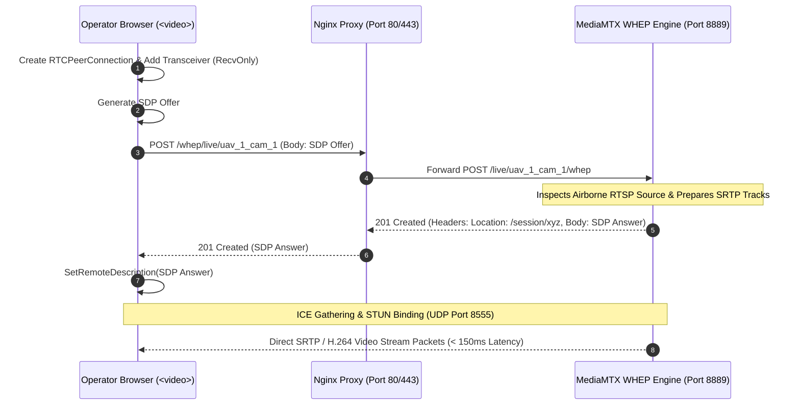

# Video Streaming Architecture Specification
## Fireblade Ground Control Station (GCS)

---

### Document Metadata
- **Module:** Real-Time Video Pipeline & Media Distribution
- **Latency Target:** Glass-to-Glass < 150 milliseconds
- **Protocols:** RTSP (Ingress) / WebRTC WHEP (Egress)
- **Engines:** MediaMTX (v1.6+) / GStreamer (1.22+)

---

## 1. Camera-To-Browser Pipeline Overview

Low-latency video streaming is critical for manual piloting, payload targeting, obstacle detection, and situational awareness. Standard video protocols like HLS, DASH, or RTMP introduce 2 to 10 seconds of latency—completely unacceptable for flight operations.

Fireblade GCS implements a **Zero-Copy WebRTC (WHEP) Passthrough Pipeline**:

```mermaid
flowchart LR
    subgraph AirSegment["Airborne Payload"]
        CAM["EO / IR Camera Sensor"]
        ONBOARD_ENC["Hardware H.264 / H.265 Encoder<br/>(Ambarella / Jetson / RPi)"]
        AIR_RTSP["Airborne RTSP Server<br/>rtsp://192.168.10.X:8554/live"]
    end

    subgraph Datalink["5.8 GHz COFDM / LTE Link"]
        IP_LINK["Ethernet Over RF Datalink<br/>(Silvus / Microhard / Doodle Labs)"]
    end

    subgraph ServerHost["Fireblade GCS Host (Server PC)"]
        direction TB
        MEDIAMTX["MediaMTX Engine<br/>RTSP Ingestion & WebRTC Relay"]
        GST_PIPE["GStreamer Transcoder (Optional)<br/>Hardware H.265 to H.264 Fallback"]
        NGINX_PROXY["Nginx Reverse Proxy<br/>/whep/* -> MediaMTX WHEP"]
    end

    subgraph BrowserClients["Browser Operators (LAN)"]
        OP_PILOT["Pilot HUD Video (< 150ms)"]
        OP_PAYLOAD["Payload Specialist Video (< 150ms)"]
        OP_CMD["Commander Video Wall (< 150ms)"]
    end

    CAM --> ONBOARD_ENC
    ONBOARD_ENC --> AIR_RTSP
    AIR_RTSP ===|UDP / TCP Stream| IP_LINK
    IP_LINK ===> MEDIAMTX
    MEDIAMTX -.->|If H.265 Transcode Required| GST_PIPE
    GST_PIPE -.-> MEDIAMTX
    MEDIAMTX --> NGINX_PROXY
    NGINX_PROXY ===|WHEP HTTP Signaling| OP_PILOT & OP_PAYLOAD & OP_CMD
    MEDIAMTX ===|WebRTC SRTP Media (UDP 8555)| OP_PILOT & OP_PAYLOAD & OP_CMD
```

---

## 2. MediaMTX Core Configuration (`mediamtx.yml`)

MediaMTX acts as the ultra-fast, zero-dependency streaming gateway on the server:

```yaml
# deploy/mediamtx/mediamtx.yml
logLevel: info
logDestinations: [stdout]

# RTSP Ingestion Server
rtsp: yes
rtspAddress: :8554
protocols: [udp, multicast, tcp]

# WebRTC Streaming Configuration
webrtc: yes
webrtcAddress: :8889
webrtcEncryption: no # Terminated by Nginx or local air-gapped LAN
webrtcServerKey: ""
webrtcServerCert: ""
webrtcAllowOrigins: ["*"]
# Single port multiplexing prevents firewall exhaustion
webrtcLocalUDPAddress: :8555
webrtcIPsFromInterfaces: yes

# Ingestion Stream Paths
paths:
  # Dynamic UAV stream path pattern: e.g. rtsp://server:8554/live/uav_1_cam_1
  live/~^uav_(?P<vehicleId>[0-9]+)_cam_(?P<camId>[0-9]+)$:
    source: rtsp://192.168.10.$vehicleId:8554/cam$camId
    sourceOnDemand: yes
    sourceOnDemandStartTimeout: 5s
    sourceOnDemandCloseAfter: 15s
    maxReaders: 50
    # Zero transcoding pass-through when incoming stream is H.264
```

---

## 3. WebRTC HTTP Egress Protocol (WHEP) Negotiation

WHEP (IETF draft-murillo-whep) provides a simple, standard HTTP POST handshake for WebRTC media session initiation:



---

## 4. Multi-Camera Switching (Electro-Optical vs. Thermal IR)

Tactical payloads frequently carry dual-sensor gimbals:
- **Sensor 1:** Electro-Optical (EO) Daytime 4K/1080p Color Camera.
- **Sensor 2:** Long-Wave Infrared (LWIR) Thermal 640x512 Sensor.

### 4.1 Switching Implementation
The operator UI provides an instant toggle:
1. Both streams are ingested by MediaMTX under isolated paths (`/live/uav_1_cam_1` and `/live/uav_1_cam_2`).
2. The UI `WebRtcPlayer` component changes its target WHEP URL when the operator clicks the EO/IR button.
3. MediaMTX's `sourceOnDemand` feature ensures that thermal streams consume zero radio bandwidth when no operator is actively viewing them.

---

## 5. Failover & Jitter Buffer Management

- **Zero-Latency Jitter Buffer:** In standard WebRTC, browsers buffer 100-300ms of frames to smooth jitter. Fireblade's player applies `playoutDelayHint = 0` and `jitterBufferTarget = 0` via the WebRTC statistics API to enforce minimum latency.
- **Blank Frame Injection:** If the airborne camera drops Wi-Fi packets, MediaMTX holds the last decoded frame for 500ms before displaying a standardized "VIDEO SIGNAL LOST" overlay, preventing player crash.
- **Auto-Reconnect:** If the WebSockets or ICE connection state transitions to `disconnected` or `failed`, the frontend player automatically attempts renegotiation every 2000ms.

